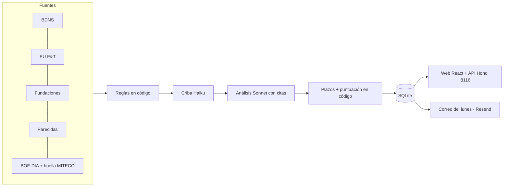

# Radar Reforesta

Radar de convocatorias y financiadores para [Reforesta](https://reforesta.es), hecho para el reto
[1hack A Coruña / Common Seeds](https://common-seeds.theagilemonkeys.com/onehack). Código abierto (MIT).

> English summary: [see below](#english-summary).

## El problema

Reforesta es una ONG de restauración ecológica con más de 30 años y 6–7 personas. Presenta unas **4–5 solicitudes al año**,
encontradas "en Google o mirando las mismas cuatro fuentes". Alrededor del **90 % de sus ingresos son privados** (en 2023: donaciones
343.461 €, servicios 105.008 €, subvenciones 58.161 €) y el canal de empresas (RSC) está a cero: solo llegan las que se acercan solas.
Lo que les falta no es capacidad de redactar, sino de **encontrar y priorizar**. Este proyecto no redacta propuestas ni rellena
formularios: busca, filtra, ordena y explica por qué.

## Qué hace

Cada día recoge convocatorias y señales de empresas, decide cuáles encajan con el perfil de Reforesta, las ordena con una puntuación
explicable y lo enseña en una **web** (que se puede abrir desde el primer día) y en un **correo cada lunes a las 8:00**.

| Canal | Fuentes |
|---|---|
| Subvenciones públicas | BDNS (Base de Datos Nacional de Subvenciones) y EU Funding & Tenders (LIFE, Horizon Europe, Erasmus+…) |
| Fundaciones y RSC | Páginas de convocatorias de fundaciones privadas vigiladas (Montemadrid, Repsol, Iberdrola, BBVA…; editable desde la web). Solo se llama al LLM cuando la página cambia |
| Descubrimiento | Lo que han ganado desde 2022 organizaciones parecidas a Reforesta (GREFA, Grupo Brinzal, SEO/BirdLife…): si su serie tiene una edición nueva, entra como candidata |
| Empresas | (1) Declaraciones de impacto ambiental del BOE que obligan a una empresa a restaurar o compensar hábitat; (2) Registro de huella de carbono del MITECO, en dos niveles: A (compensan, motivo concreto) y B (gran empresa afín de la zona, baja confianza, oculto por defecto) |

Por cada convocatoria: criba barata (Claude Haiku) y análisis con **cita literal** de importe, plazo y requisitos (Claude Sonnet). Lo que
no consta se marca como *desconocido*, nunca se inventa. Además: plazos de cierre calculados en código (con festivos), ganadores
previos de la misma línea, decisiones y notas del equipo ("Nos interesa", "Descartar" con motivo; el radar aprende de ellas) y la
página `/como-sabemos` con el backtest.

## Cómo prioriza

Cada candidata en juego recibe una puntuación **0–100 explicable**, calculada en código (sin LLM) con cinco factores visibles en la
ficha ("Por qué está donde está"): **encaje** con las líneas de Reforesta, **importe**, **tiempo hasta el cierre**, **esfuerzo**
(cofinanciación, requisitos) y **probabilidad** (ediciones ganadas por Reforesta y por organizaciones parecidas). Un dato que falta no
cuenta como bueno: vale un valor neutro y la explicación dice "desconocido". Pesos y umbrales en `seed/puntuacion.json`.

"Esta semana" lista todas las abiertas en juego en tres secciones sin solapes (cierran pronto > nuevas > abiertas) y una lista paralela
"Las ganan organizaciones como vosotros". Detalle en [Puntuación y ranking](#puntuación-y-ranking).

## Cómo sabemos que funciona

Página pública `/como-sabemos` (resultados en `seed/backtest.json`, `npm run backtest`). Dos pruebas, con la advertencia de que es una
**reclasificación con las reglas de hoy, no una reproducción histórica**:

- **(a) Convocatorias conocidas: 6 de 6 detectadas.** La convocatoria anual de la Comunidad de Madrid a la que se presenta Reforesta
  (ediciones 2022–2026, 5 filas, con la Orden 1689/2026 del reto = edición 2026) y la convocatoria de MITECO 923290 pasan reglas y criba, de modo
  que aparecerían en "Esta semana". La puntuación se muestra como dato, no como criterio de éxito (sin análisis, 38–47 sobre un máximo
  de ~47: depende sobre todo de si el plazo es conocido).
- **(b) Descubrimiento: 23 de 25 (92 %) pasan la criba.** Son convocatorias ganadas desde 2022 por organizaciones parecidas (de 308
  examinadas, 25 cumplen las reglas objetivas: no nominativas ni de concesión directa, ámbito del perfil, finalidad ambiental, admiten
  entidades sin ánimo de lucro, sin las ganadas por Reforesta). Reforesta no figura entre sus ganadores (BDNS no publica quién perdió).
  **Ese porcentaje no es una precisión**: el conjunto está prefiltrado por palabras clave, no tiene control negativo y se juzga con los
  documentos y el perfil de hoy.

Coste del backtest completo en una pasada real: 31 llamadas a Haiku, 0,014 USD.

## Capturas

Pendientes: ver [`docs/capturas/LEEME.md`](docs/capturas/LEEME.md) para lo que hay que capturar y con qué nombre.

## Arquitectura



Node 24 (TypeScript sin compilar), SQLite (`node:sqlite`), Hono para la API, Vite + React para la web, Anthropic SDK. Un solo contenedor
Docker; un cron diario ejecuta `npm run radar` y otro, los lunes, `npm run digest`.

## Arrancar en local

Requiere Node 24 o Docker.

```sh
npm install
cp .env.example .env     # y rellena ANTHROPIC_API_KEY (ver tabla de variables)
npm run radar            # una pasada: fuentes → reglas → criba → análisis → plazos → puntuación → SQLite (data/radar.sqlite)
npm run build            # compila la web (dist/web)
npm start                # web + API en http://127.0.0.1:8116
npm test                 # node --test (respuestas reales grabadas de BDNS, UE, BOE, fundaciones y MITECO)
npm run digest -- --vista-previa   # escribe data/digest-preview.html sin enviar nada
```

Con Docker:

```sh
docker compose up -d                          # web + API en http://127.0.0.1:8116
docker compose run --rm radar npm run radar   # una pasada del radar
```

Sin `ANTHROPIC_API_KEY` el radar se salta la criba y el análisis y lo apunta en el registro de la ejecución (`/api/ejecuciones`), donde
también queda el coste de LLM de cada fase. El perfil de Reforesta se carga de `seed/perfil.json` la primera vez y después se edita en
la web. `npm run record:*` regraba los datos de prueba (BDNS, concesiones, parecidas, UE, fundaciones, BOE, huella).

## Despliegue

Servidor propio con Docker, una carpeta con `compose.yaml` y `.env`, la web solo en `127.0.0.1` y expuesta por un túnel de Cloudflare
(o un nginx con TLS); dos cron (radar diario 07:00, resumen los lunes 08:00, hora de Madrid). Paso a paso, con los comandos exactos,
en [`deploy/PASOS.md`](deploy/PASOS.md) (`deploy/desplegar.sh`, `deploy/instalar-cron.sh`, `deploy/crontab.txt`). Antes de nada,
rellena el `.env` a partir de [`deploy/.env.produccion.example`](deploy/.env.produccion.example). Los datos son un único fichero SQLite
(`data/radar.sqlite`, bind mount): copiarlo es la copia de seguridad.

## Variables de entorno

Solo hay una obligatoria. Todas las demás tienen valor por defecto (en `src/config.ts`); `.env.example` las lista comentadas.

| Variable | Obligatoria | Por defecto | Para qué |
|---|---|---|---|
| `ANTHROPIC_API_KEY` | **sí** (sin ella no hay criba ni análisis ni empresas con LLM) | — | Clave de la API de Claude |
| `RESEND_API_KEY` | solo para el correo | — | Envío del resumen semanal |
| `RADAR_DIGEST_DESTINATARIOS` | solo para el correo | vacío = no se envía | Destinatarios, separados por comas |
| `RADAR_DIGEST_REMITENTE` | no | `Radar Reforesta <no-reply@out.ruralhackers.com>` (cámbialo: debe ser un dominio verificado en Resend) | Remitente |
| `RADAR_URL_PUBLICA` | recomendada | — | URL pública, para los enlaces del correo |
| `TEAM_PASSWORD` | no | vacío = demo pública | Activa el modo privado (ver abajo) |
| `SESSION_SECRET` | recomendada con `TEAM_PASSWORD` | — | Secreto aleatorio (`openssl rand -hex 32`) que firma la cookie |
| `RADAR_COOKIE_SECURE` | no | según https / `X-Forwarded-Proto` | `1` tras el túnel (la app ve http local) |
| `RADAR_CONFIAR_X_FORWARDED_FOR` | no | vacío | `1` solo tras un proxy propio que fije la cabecera |
| `PORT` | no | `8116` | Puerto publicado (compose lo enlaza a 127.0.0.1) |
| `TZ` | no | `Europe/Madrid` (fijado en `compose.yaml`) | Zona horaria del contenedor |
| `DB_PATH` | no | `data/radar.sqlite` | Fichero SQLite |
| `SEED_FILE`, `FESTIVOS_FILE`, `PUNTUACION_FILE` | no | `seed/perfil.json`, `seed/festivos.json`, `seed/puntuacion.json` | Semillas (ver "Adaptarlo a otra ONG") |
| `LOOKBACK_DAYS` | no | `7` | Días hacia atrás que revisa cada pasada |
| `RADAR_MODELO_CRIBA`, `RADAR_MODELO_ANALISIS` | no | `claude-haiku-5-5`, `claude-sonnet-5-5` | Modelos |
| **`RADAR_MAX_ANALISIS`** | no | `20` (la producción de ejemplo pone `60`) | **Tope de análisis (Sonnet) por pasada; el principal control de coste** |
| `RADAR_DIAS_PENDIENTES` | no | `30` | Días en que se reintentan criba y análisis pendientes |
| `RADAR_EJEMPLOS_DECISIONES` | no | `20` | Decisiones del equipo que van como ejemplos a los prompts |
| `RADAR_DIAS_CACHE_GANADORES`, `RADAR_MAX_PETICIONES_GANADORES`, `RADAR_PAUSA_BDNS_MS` | no | `7`, `200`, `250` | Concesiones de BDNS: caché, tope de peticiones y pausa |
| `RADAR_MAX_PETICIONES_PARECIDAS`, `RADAR_DESDE_ANIO_PARECIDAS`, `RADAR_DIAS_EDICION_PARECIDAS` | no | `100`, `2022`, `400` | Descubrimiento por parecidas |
| `RADAR_PAUSA_FT_MS`, `RADAR_MAX_PETICIONES_FT` | no | `500`, `8` | EU Funding & Tenders |
| `RADAR_PAUSA_FUNDACIONES_MS`, `RADAR_TIMEOUT_FUNDACIONES_MS`, `RADAR_MAX_BYTES_FUNDACIONES`, `RADAR_MAX_FUNDACIONES`, `RADAR_MAX_CARACTERES_FUNDACIONES` | no | `1000`, `30000`, `3145728`, `60`, `60000` | Fundaciones vigiladas |
| `RADAR_DIAS_DIA_BOE`, `RADAR_MAX_DIA_BOE`, `RADAR_PAUSA_BOE_MS`, `RADAR_MAX_CARACTERES_DIA_BOE` | no | `60`, `40`, `300`, `150000` | Empresas desde las DIA del BOE |
| `RADAR_MAX_HUELLA`, `RADAR_SECTORES_HUELLA`, `RADAR_ANIOS_HUELLA`, `RADAR_TIMEOUT_HUELLA_MS` | no | `50`, `B,D,E,F,G,H`, `3`, `60000` | Registro de huella de carbono |
| `BACKTEST_DB`, `BACKTEST_MAX_B`, `BACKTEST_MAX_DETALLES_B`, `BACKTEST_FILE` | no | `data/backtest/trabajo.sqlite`, `150`, `400`, `seed/backtest.json` | Backtest "Cómo sabemos" |

## Modo privado

Sin `TEAM_PASSWORD` todo es público y editable: es el modo demo. Con ella, convocatorias, "Esta semana", empresas y "Cómo sabemos"
siguen públicas, pero decisiones, notas, perfil, organizaciones parecidas, fundaciones y estado de empresas piden contraseña (cookie
firmada de 180 días; cambiar la contraseña la invalida). Las respuestas públicas nunca incluyen decisiones ni notas. Pon también
`SESSION_SECRET` y, tras el túnel, `RADAR_COOKIE_SECURE=1`. Detalle (fuerza bruta, CSRF) en [Modo privado (`TEAM_PASSWORD`)](#modo-privado-team_password).

**Alternativa: Cloudflare Access.** Si la web va tras Cloudflare Tunnel, puedes dejar `TEAM_PASSWORD` vacío y proteger todo el
hostname con una aplicación de Cloudflare Access (Zero Trust > Access > Applications, política por correo o dominio de la
organización). Así el login lo gestiona Cloudflare (correo con código, Google…) y la app no guarda ninguna contraseña; a cambio, la
web deja de ser pública (tampoco "Cómo sabemos"), y el equipo es "todo el que pase Access".

**Aviso sobre `CF-Connecting-IP`.** El límite de intentos fallidos por IP se apoya en esa cabecera, que la app acepta sin más porque
el puerto está en `127.0.0.1` y solo se llega por el túnel (que la fija). Si expones el puerto directamente, se puede falsificar y el
límite se esquiva: no lo expongas, o ponlo tras un proxy que la sobrescriba. Y al revés: 10 fallos desde una misma IP/NAT bloquean
durante 15 minutos hasta la contraseña correcta.

## Coste mensual estimado

Solo hay coste de la API de Claude (Haiku 5.5: 0,10 / 0,50 USD por millón de tokens de entrada/salida; Sonnet 5.5: 2 / 10) y, si se
quiere, Resend (el plan gratuito sobra para un correo semanal). Cifras de **ejecuciones reales** (informes de las tareas 2, 11–15):

| Pieza | Coste medido |
|---|---|
| Criba (Haiku) de una pasada completa con BDNS + UE: 148 convocatorias | ≈ 0,05–0,07 USD (toda la pasada, 0,082 USD) |
| Análisis con citas (Sonnet) | ≈ 0,15 USD cada uno (0,145 USD de media; las bases largas lo suben) |
| Empresas, DIA del BOE (60 días, 18 resoluciones leídas) | 0,063 USD la primera vez |
| Empresas, huella de carbono (79 llamadas) | 0,018 USD |
| Backtest completo (31 llamadas) | 0,014 USD |

Todo se cachea (respuestas del LLM por contenido, huella de las páginas, resoluciones ya leídas): repetir una pasada sin novedades cuesta
0 USD, así que **ejecutando a diario solo se paga lo nuevo**. Estimación (no medida a un mes completo): criba y empresas, **1–3 USD/mes**;
análisis, unos 10–40 al mes (lo que pasa la criba y es nuevo) = **1,5–6 USD/mes**. Total en régimen: **unos 3–10 USD al mes**.
La primera pasada sobre una BD vacía es mayor (hasta 20–60 análisis pendientes = 3–9 USD, repartidos en varias pasadas por el tope).

**Cómo acotarlo:** `RADAR_MAX_ANALISIS` es el techo duro (cada pasada analiza como mucho esas convocatorias y deja el resto para la
siguiente): con 20 y ejecución diaria, el máximo teórico es 20 × 0,15 × 30 ≈ 90 USD/mes, que solo se alcanzaría si cada día hubiera 20
convocatorias nuevas que superasen la criba. Para un tope más estricto, bájalo (p. ej. 5 → máximo ≈ 22 USD/mes) o ejecuta el radar menos
veces. `RADAR_MAX_DIA_BOE` y `RADAR_MAX_HUELLA` limitan las lecturas de empresas, y `/api/ejecuciones` muestra el coste real de cada
pasada por fase.

## Adaptarlo a otra ONG

Todo lo específico de Reforesta está en `seed/`, no en el código:

- `seed/perfil.json`: perfil (nombre, NIF, líneas, ámbito, importe mínimo…), `fundaciones` vigiladas y `organizacionesParecidas` (NIF de entidades que ganan lo mismo que vosotros; se pueden añadir también desde la web). Se carga si la
  BD no tiene perfil (`npm run seed`); después se edita en la página Perfil.
- `seed/puntuacion.json`: pesos y umbrales de la puntuación (el campo `_` lo documenta).
- `seed/festivos.json`: festivos nacionales y autonómicos para contar días hábiles (añade el año o la región que falte).
- `seed/backtest.json`: se regenera con `npm run backtest`. Las convocatorias conocidas del conjunto (a) están en `src/backtest/conjuntos.ts`:
  sustitúyelas por las vuestras.

Para otra ONG: cambia el perfil, el NIF (para ver vuestro historial de concesiones en BDNS), las parecidas y las fundaciones, y lanza
una pasada.

## Límites conocidos

- **BDNS solo tiene concesiones desde 2022** y solo publica ganadores: la ficha dice "no figura entre los ganadores", nunca "perdió".
- **La probabilidad es débil**: se apoya en pocas ediciones y en organizaciones parecidas; sin historial propio es neutra.
- **El backtest no es una validación estadística**: 6 conocidas y 25 de descubrimiento, prefiltradas por palabras clave y sin control
  negativo; el 92 % no es una precisión. No hay todavía una medición de falsos negativos.
- **Sin el análisis, la puntuación es parcial** (máximo ~47): importe, encaje y esfuerzo cuentan como desconocidos hasta que Sonnet lee las bases.
- **Los plazos "desconocidos"** (varios plazos en un texto, notificación, semanas…) se muestran con el texto original, no se adivinan. No incluye
  fiestas locales.
- **Fundaciones**: algunas webs bloquean a los clientes automáticos (p. ej. "la Caixa", HTTP 403; en la semilla, desactivada con su nota).
  La lista de la semilla es corta: hay que ir ampliándola desde la web.
- **Empresas**: las DIA dan un motivo verificable pero no un contacto; no se guardan personas ni se leen webs de RSC. El nivel B de la
  huella es de baja confianza.
- **No redacta propuestas ni presenta solicitudes.** Tampoco gestiona sedes electrónicas.
- **SSRF**: las descargas validan DNS y redirecciones, pero queda el DNS rebinding entre la resolución y la conexión.
- **Un único usuario "equipo"**: no hay cuentas individuales (las notas llevan un autor opcional).
- Español para las convocatorias españolas; las de la UE están en inglés y el análisis se devuelve en castellano con la cita en inglés.

## Licencia y créditos

[MIT](LICENSE). Hecho por [Rural Hackers](https://ruralhackers.com) para [Reforesta](https://reforesta.es) en el reto 1hack A Coruña de
[Common Seeds](https://common-seeds.theagilemonkeys.com/onehack) (The Agile Monkeys). Los datos vienen de fuentes públicas: BDNS
(IGAE), portal Funding & Tenders de la Comisión Europea, BOE (datos abiertos) y el Registro de huella de carbono del MITECO. Diseño y
decisiones: [`docs/superpowers/specs/2026-11-13-reforesta-radar-design.md`](docs/superpowers/specs/2026-11-13-reforesta-radar-design.md).
Guion del vídeo: [`docs/guion-video.md`](docs/guion-video.md).

## English summary

**Radar Reforesta** is an open-source (MIT) funding-call radar built for Reforesta, a Spanish ecological-restoration NGO with 6–7 staff
that files only 4–5 applications a year and gets about 90 % of its income from private sources, with a corporate (CSR) channel at zero.
Their bottleneck is not writing proposals but *finding and prioritising* opportunities. Every day the radar collects calls from Spain's
national subsidies database (BDNS), EU Funding & Tenders, a watch-list of private foundations, and from what similar NGOs have won since
2022. It also surfaces companies with a verifiable reason to fund restoration: environmental impact declarations in the Spanish
official gazette that oblige them to compensate habitat, and the national carbon-footprint registry. A cheap LLM screening step
(Claude Haiku) and a cited analysis (Claude Sonnet) read each call; every amount, deadline and requirement carries a literal quote
and a link, and anything unknown is marked as unknown, never invented. A transparent 0–100 score (five visible factors, computed in
code) ranks what is worth the effort, shown on a web app and in a short Monday e-mail. A public "How we know" page backtests it:
6 of 6 known calls detected, and 23 of 25 calls won by similar organisations pass the screening (explicitly *not* a precision figure).
Estimated running cost is roughly 3–10 USD per month, capped by one setting. Deploy with `docker compose`; adapt it to another NGO by editing
the files in `seed/`. The README, UI and prompts are in Spanish.

---

## Referencia técnica

Detalle de cada pieza, tal como funciona hoy.

### Plazos de solicitud

Cada candidata tiene una fecha de cierre **literal** (la da la fuente o está escrita en el texto), **calculada** o **desconocida**
(con el texto original a la vista). Se calcula en código, sin LLM, en cada ejecución (`src/plazos.ts`, tabla `plazos`).

Calculado, siempre desde la publicación (del extracto en boletín si consta su fecha; si no, desde el registro en BDNS y se marca
como *aproximada*):

- "N días hábiles" (cifras o letra, "décimo quinto día hábil"): desde el día siguiente, sin sábados, domingos ni festivos.
  "N días" sin calificar se entienden hábiles (art. 30.2 Ley 39/2015).
- "N días naturales" y "un mes / N meses" (de fecha a fecha; si el mes no tiene ese día, el último): si el último día es inhábil,
  pasa al primer hábil siguiente.
- Desconocido: "desde el inicio del plazo" si el texto de inicio no es "día siguiente a la publicación"; notificación, aprobación, apertura; semanas; "días laborables"; varios plazos en el
  mismo texto; sin referencia a la publicación; años sin festivos en el fichero.

Los festivos viven en `seed/festivos.json` (2025–2027: nacionales y Comunidad de Madrid, de las resoluciones de la Dirección General
de Trabajo en el BOE); se aplican los de las regiones del perfil. No incluye fiestas locales. Para otro año, añadirlo al fichero
(`FESTIVOS_FILE` cambia la ruta).

### Puntuación y ranking

Cada candidata en juego recibe una puntuación **0–100 explicable**, calculada en código, sin LLM, en cada ejecución
(`src/puntuacion.ts`, fase `puntuacion`; el desglose se guarda en la tabla `puntuaciones` y se ve en la ficha, "Por qué está donde está").
Es una suma ponderada de cinco factores, cada uno con una subpuntuación 0–1 y una explicación de una línea:

| Factor | Qué mira |
|---|---|
| encaje | líneas de Reforesta con las que encaja el análisis (Sonnet) y si admite entidades sin ánimo de lucro |
| importe | máximo por proyecto (o, si solo consta, el total, que vale menos) frente al mínimo del perfil, en escala logarítmica |
| cierre | días que faltan según el plazo (poco tiempo penaliza; muy lejano, algo menos) |
| esfuerzo | % de cofinanciación y número de requisitos con cita |
| probabilidad | enchufable (`ProveedorProbabilidad`): hoy sin datos (valor neutro, "desconocida"); el ticket de ganadoras e historial propio lo rellena |

Un dato que falta **no cuenta como bueno**: el factor vale su `valorDesconocido` y la explicación dice "desconocido".
Quedan fuera del ranking (con el motivo guardado) las que no admiten entidades sin ánimo de lucro y las ya cerradas.

**Pesos y umbrales: `seed/puntuacion.json`** (`PUNTUACION_FILE` cambia la ruta; documentado dentro, campo `_`). Los pesos son relativos
(no tienen que sumar 100). Al cambiarlos, la siguiente pasada del radar recalcula todo.

"Esta semana" (`GET /api/semana`) lista **todas las abiertas en juego**, ordenadas por puntuación y divididas en tres secciones:
**cierran pronto** (cierre en `cierranProntoDias`, 21 por defecto), **nuevas** (vistas por primera vez en los últimos `nuevasDias`, 7) y
**abiertas** (el resto: cierre lejano o desconocido). Una convocatoria sale en **una sola** (cierran pronto > nuevas > abiertas), así que
nunca se pierde una que encaja. Las cerradas y las excluidas no salen. La API calcula la puntuación en el momento de la petición con el
reloj de ese momento (función pura y barata): total, explicación del cierre y secciones son siempre coherentes; lo guardado en
`puntuaciones` por cada pasada es solo registro (y se borra para las que dejan de estar en juego).

### Ganadores previos y organizaciones parecidas

Cada ejecución consulta en BDNS las concesiones de Reforesta (por NIF), de cada candidata y de las ediciones anteriores de su serie
(mismo órgano y título salvo el año, p. ej. «proyectos ambientales» de la CAM 2022-2026). BDNS solo tiene concesiones desde 2022 y solo
publica ganadores: la ficha dice «no figura entre los ganadores», nunca «perdió». Las organizaciones parecidas (origen `calculada`) son las
entidades que ganaron lo mismo que Reforesta; las `manual` y las desactivadas (`activa = 0`) no se tocan al recalcular. El factor de
probabilidad sube con las ediciones ganadas por Reforesta y con las parecidas entre los ganadores. `npm run record:concesiones` regraba los
datos de prueba (`test/fixtures/bdns-concesiones`).

### Descubrimiento por organizaciones parecidas

Antes de la criba, el radar trae de BDNS lo que han ganado desde 2022 las organizaciones parecidas **activas** (por NIF; caché de 7 días) y,
de cada convocatoria que ganaron (desde 2022, configurable con `RADAR_DESDE_ANIO_PARECIDAS`), busca si su serie tiene una **edición nueva** (año posterior) que no esté resuelta
ni haya cerrado. Esa edición es candidata y sigue el camino normal (reglas, criba, análisis, puntuación) con el origen «parecidas» y la
organización y edición anterior que la ganó. Sin duplicados: el id es el de BDNS (`bdns:<número>`); si ya venía del listado directo solo se
le añade la etiqueta. Las descubiertas solo por esta vía dejan de estar en juego en cuanto ninguna parecida activa las respalda (desactivar
una organización la excluye en la siguiente ejecución; las etiquetas se reconstruyen en cada pasada). Comparte con la fase de ganadores el
tope de peticiones a BDNS (`RADAR_MAX_PETICIONES_GANADORES`; el descubrimiento gasta como mucho `RADAR_MAX_PETICIONES_PARECIDAS`) y la pausa.
Usa las parecidas ya guardadas (semilla, manuales y las calculadas en la ejecución anterior).

**«Las ganan organizaciones como vosotros»** es una lista **paralela** en «Esta semana» (campo `lasGananParecidas` de `/api/semana`, por
puntuación): convocatorias en juego con origen «parecidas» o con una parecida activa entre sus ganadores previos. No es una cuarta
sección excluyente: la convocatoria sale además en su sección principal (cierran pronto > nuevas > abiertas), para que una urgente no se
pierda por ser también de parecidas. Cada convocatoria lleva `parecidas: { descubierta, organizaciones[{nif, nombre, anios}] } | null`.

Ajuste en la web (`/parecidas`) y API: `GET /api/parecidas` (nombre, NIF, origen, coincidencias, activa, convocatorias aportadas),
`PATCH /api/parecidas/:nif {activa}`, `POST /api/parecidas {nif, nombre?}` (alta manual; solo NIF de entidad), `DELETE /api/parecidas/:nif`
(solo manuales; las demás se desactivan). Las escrituras están en un sub-router aparte para protegerlas con `TEAM_PASSWORD`.
`npm run record:parecidas` regraba los datos de prueba (GREFA y Grupo Brinzal, reloj 20/08/2026).

### Decisiones del equipo y aprendizaje

En la ficha y en cada fila de "Esta semana": "Nos interesa" o "Descartar" con un motivo de un clic ("Otro" con texto libre), y notas con fecha y autor opcional en la ficha. `/nos-interesa` lista lo marcado por plazo (el más próximo primero, plazo desconocido al final). Todo es reversible. Se guarda en las tablas `decisiones` y `notas`, que ninguna ejecución toca. Lo descartado deja de salir en "Esta semana" (también en la lista de parecidas) y no se criba ni analiza si aún no tenía veredicto.

Aprendizaje: las últimas `RADAR_EJEMPLOS_DECISIONES` (20) decisiones, con título, órgano y resumen corto, van como ejemplos al final del texto de sistema de la criba y el análisis de las convocatorias NUEVAS. Los veredictos ya guardados no se rehacen al decidir. Añadir una decisión cambia el texto de sistema y por tanto la clave de `llm_cache` (esperado: solo lo aún sin veredicto paga una llamada nueva).

### Modo privado (`TEAM_PASSWORD`)

Sin `TEAM_PASSWORD` (ausente o vacía) todo es público y editable (demo). Con ella: convocatorias, "Esta semana", empresas y "Cómo sabemos" siguen
públicas, pero decisiones, notas, perfil (escritura), organizaciones parecidas (escritura) y lo que añadan las tareas de fuentes vigiladas y estado de
empresas piden contraseña (401 sin sesión). Las respuestas públicas nunca incluyen decisiones ni notas; lo descartado por el equipo sigue
ocultándose de `/api/semana` para todos.

- `POST /api/sesion {password}` compara en tiempo constante y da una cookie `radar_equipo` firmada (HMAC), HttpOnly, SameSite=Lax, de 180 días
  (Secure si la petición es https / `X-Forwarded-Proto: https`, o forzado con `RADAR_COOKIE_SECURE`). `DELETE /api/sesion` sale; `GET /api/sesion`
  devuelve `{ modoPrivado, autenticado }`.
- La clave de firma sale de `TEAM_PASSWORD` y `SESSION_SECRET` (opcional pero recomendado): cambiar cualquiera invalida las cookies antiguas.
- Fuerza bruta: pausa de 0,5 s ante contraseña errónea y límite en memoria de 10 intentos fallidos por IP cada 15 min (429; el intento se reserva antes de
  leer el cuerpo, así que las ráfagas en paralelo no lo esquivan). No hay bloqueo global: una contraseña correcta nunca se rechaza por fallos de otras IP.
  IP del cliente: `CF-Connecting-IP` (Cloudflare Tunnel); `X-Forwarded-For`/`X-Real-IP` solo con `RADAR_CONFIAR_X_FORWARDED_FOR=1`; sin cabecera, la
  dirección del socket. `CF-Connecting-IP` se acepta sin más porque el puerto está en 127.0.0.1 y solo se llega por Cloudflare Tunnel (que la fija):
  si se expone el puerto directamente, esa cabecera se puede falsificar y el límite se esquiva (no lo expongas, o ponlo tras un proxy que la sobrescriba).
  Ojo: el límite por IP bloquea también la contraseña correcta tras 10 fallos desde la misma IP/NAT durante 15 min (429). En el VPS pon `RADAR_COOKIE_SECURE=1` (la app ve http local tras el túnel).
- CSRF: SameSite=Lax y las escrituras exigen `Content-Type: application/json` (415 si no).
- Para marcar una ruta nueva como privada, ver la cabecera de `src/api/equipo.ts`: sub-router con `router.use('*', acceso.requiereEquipo)`.

### Correo del lunes

`npm run digest` envía por Resend (HTTP directo, sin dependencias) el resumen semanal: destacadas con su porqué, las que cierran pronto y las que ganan organizaciones parecidas, con enlace a cada ficha. Variables: `RESEND_API_KEY`, `RADAR_DIGEST_DESTINATARIOS` (separados por comas; vacío = no se envía nada), `RADAR_DIGEST_REMITENTE`, `RADAR_URL_PUBLICA`. Una vez por semana ISO (`--forzar` para repetir); cada envío queda en la tabla `envios_resumen`. `npm run digest -- --vista-previa` escribe `data/digest-preview.html` sin enviar.

### Fuente EU Funding & Tenders

Además de BDNS, cada ejecución consulta el portal de la UE (LIFE, Horizon Europe, Erasmus+…) por su API pública de búsqueda (SEDIA):
`POST https://api.tech.ec.europa.eu/search-api/prod/rest/search?apiKey=SEDIA&text=<términos>&pageSize=50&pageNumber=N` con una parte multipart
`query` (JSON: `type=1` topics, `status` abierta o próxima, `language=en`, `deadlineDate >= hoy`). Un cuerpo JSON normal se ignora en silencio.
Ids `ft:<identificador>` (fuente `eu_ft`, órgano «UE · programa»), plazo literal con la fecha límite (hora de Bruselas; con varios cortes, el primero
que no ha pasado) y enlace a la ficha del topic en el portal. Pre-filtro en código por temas del perfil (biodiversidad, restauración, bosque, naturaleza,
adaptación, educación ambiental; todo LIFE); el resto se guarda descartado con motivo `tema`. Luego, criba (Haiku) y análisis (Sonnet) como las de BDNS:
los textos están en inglés y el prompt pide responder en castellano (las citas, en inglés literal).
Cortesía con el servidor: pausa entre páginas (`RADAR_PAUSA_FT_MS`) y tope de peticiones (`RADAR_MAX_PETICIONES_FT`, 8). Si el portal falla, queda en el
registro de la ejecución y el resto de fuentes sigue. Duplicados: si una convocatoria de otra fuente tiene el mismo título normalizado (≥ 4 palabras)
que una de BDNS, se conserva la de BDNS y la otra se marca `duplicada`. Grabaciones de los tests: `npm run record:eu-ft`.

### Fundaciones privadas vigiladas

Reforesta recibe la mayor parte de sus ingresos de fundaciones y programas de RSC, así que se vigilan igual que las convocatorias públicas. La lista (tabla
`fundaciones`, con una semilla en `seed/perfil.json`: Montemadrid, "la Caixa", Repsol, Iberdrola, Endesa, BBVA, Mapfre, Santander, Fundación Biodiversidad,
Corresponsables y MITECO como agregadores…) se edita desde la página **Fundaciones** (añadir con URL + nombre + tipo, pausar, quitar; solo el equipo).
Cada ejecución, para cada fuente activa: descarga la página (UA genérico, pausa `RADAR_PAUSA_FUNDACIONES_MS`, tiempo y tamaño máximos), saca su texto principal
(sin menús, pies ni banners; los enlaces quedan como «texto [url]») y compara su huella con la guardada. **Sin cambios no hay ninguna llamada al LLM.** Con
cambios (o la primera vez), Haiku extrae las convocatorias abiertas (título, enlace, plazo, importe, extracto); el código comprueba que título, enlace, plazo,
importe y extracto salen de la página y deja vacío lo que no. Cada una entra como `fund:<host>:<hash>` (fuente `fundacion`, órgano «FUNDACIÓN · nombre»)
y sigue el camino normal (criba, análisis —descarga la página o el PDF propio de la convocatoria—, plazo, puntuación y ranking). La misma convocatoria vista
desde una fundación y desde un agregador converge en un solo id. La huella solo se guarda si la extracción salió bien (un fallo se reintenta entero).
Las fuentes cuya web bloquea a los clientes automáticos (p. ej. "la Caixa", HTTP 403) están en la semilla desactivadas con su nota. La extracción
se registra como fase `extraccion_fundaciones` con su coste. Grabaciones de los tests: `npm run record:fundaciones`.

**Seguridad de las descargas (SSRF).** Toda URL que sale de datos (páginas de fundaciones, enlaces extraídos de ellas, documentos de BDNS/UE/fundaciones
que lee el análisis) se descarga con `src/fetch-seguro.ts`: solo http(s), sin credenciales, DNS resuelto (todas las direcciones) y rechazo de loopback,
redes privadas, enlace local, CGNAT, ULA, multicast y mapeadas; redirecciones a mano (máx. 5) validadas salto a salto; cuerpo leído por streaming con tope
de tamaño. La comprobación es al descargar, así que cubre filas de la semilla y fuentes reactivadas. Límite: DNS rebinding en la ventana entre la
resolución y la conexión (el `fetch` global no permite fijar la IP). El texto de las páginas se trata como no confiable en el prompt de extracción
(marca de bloque derivada del hash del texto, topes de longitud, sin texto libre del LLM). La huella ignora contadores, horas y fechas relativas.

### Empresas desde las DIA del BOE

Canal de empresas: las que una **declaración de impacto ambiental** (o informe de impacto ambiental) del BOE obliga a restaurar o compensar son candidatas a patrocinar proyectos de restauración. Fase `empresas_dia_boe` del motor (`src/fases/empresas.ts`), con Haiku:

1. Sumario diario de datos abiertos (`https://www.boe.es/datosabiertos/api/boe/sumario/AAAAMMDD`, JSON; 404 = ese día no hay BOE), sección III, MITECO. Pre-filtro por título: «declaración de impacto ambiental» / «informe de impacto ambiental» (no correcciones de errores ni declaraciones ambientales estratégicas de planes).
2. De cada resolución nueva se descarga el texto (`https://www.boe.es/diario_boe/xml.php?id=BOE-A-…`, host fijo) y el modelo extrae sentido (favorable/desfavorable), promotor, CIF, proyecto, provincia y medidas de compensación de hábitat / reforestación / restauración / hábitat de aves, cada una con **cita literal**. El código lo comprueba contra el texto: una DIA desfavorable no obliga a nada; sin cita comprobada no hay medida; el promotor debe aparecer en el texto y no ser una administración; el motivo (una línea) lo compone el código.
3. Cada DIA con medidas es una señal de una empresa (unida por CIF o por nombre normalizado, sin acentos ni forma societaria). Estado del equipo (`pendiente`, `contactada`, `descartada`) y nota: solo escribe el equipo (`PATCH /api/empresas/:id`); la lectura pública (`GET /api/empresas`) no incluye la nota, la del equipo es `GET /api/equipo/empresas`. Página web `/empresas`.
4. No se guardan personas de contacto ni se leen webs de empresas (`pagina_rsc` queda vacío por ahora).

Primera ejecución: `RADAR_DIAS_DIA_BOE` días hacia atrás (60); después solo lo no revisado (hoy se vuelve a mirar siempre; un día solo se da por revisado si todas sus resoluciones se leyeron). Cada resolución leída no se repite (`dia_boe_procesadas`), y la caché de respuestas evita pagar el mismo texto. `RADAR_MAX_DIA_BOE` limita las lecturas con LLM por ejecución. `npm run record:boe` regraba los fixtures de los tests.

El correo del lunes añade «Empresas nuevas de la semana» (vistas por primera vez en los últimos 7 días, máximo 5, con motivo y enlace al BOE) y se envía aunque ese día no haya convocatorias que contar.

#### Empresas del registro de huella de carbono (MITECO)

Segunda fuente del canal: el [Registro de huella de carbono, compensación y proyectos de absorción](https://www.miteco.gob.es/es/cambio-climatico/temas/registro-huella.html). El MITECO publica listados en Excel; se usan dos (`src/sources/huella.ts`, lector de `.xlsx` propio y sin dependencias en `src/sources/xlsx.ts`):

- `https://www.miteco.gob.es/content/dam/miteco/es/cambio-climatico/temas/registro-huella/listados/listadohuelladecarbono.xlsx`, hoja «LISTADO»: una fila por huella inscrita (organización, NIF, sector, año, CCAA, tamaño, sello CALCULO / REDUZCO / COMPENSO…). ~22 MB; el servidor corta las descargas a 16 MiB, así que se piden por trozos con `Range`.
- `.../listadodecompensacion.xlsx`, hoja «Listado COMPENSACIONES»: quién compensó con qué proyecto de absorción (sin NIF; se casa por nombre y solo si es inequívoco).

Fase `empresas_huella_carbono` (`src/fases/huella.ts`), tras la de las DIA: pre-filtro **en código** (persona jurídica, mediana o gran empresa, huella reciente, no administración, y uno de dos niveles). **Nivel A** (prioridad 2): compensa —sello COMPENSO o compensaciones con proyectos de absorción—, es el motivo concreto. **Nivel B** (prioridad 1, baja confianza): gran empresa de un sector afín en la zona del perfil (comunidades del `ámbito`; sectores CNAE en `RADAR_SECTORES_HUELLA`, por defecto `B,D,E,F,G,H`) sin compensación: se guarda sin LLM y no se muestra por defecto (`/api/empresas?baja=1`, «Ver más» en la web). Las DIA del BOE tienen prioridad 3. `leerEmpresas` y la página ordenan DIA, nivel A, nivel B; el correo muestra como máximo 5 (DIA y nivel A). Solo las de nivel A, ordenadas por prioridad y hasta `RADAR_MAX_HUELLA` (50) por ejecución, llegan a Haiku, que puede degradarlas y solo si lo que el registro dice de ellas es nuevo o ha cambiado (hash en `huella_cribadas`). Haiku decide «posible financiadora» con un motivo de una línea; el código lo antepone con la fuente y el año, la cita es el texto literal de la fila y la empresa se guarda como origen `huella_carbono` (se une a una de las DIA por CIF o nombre con las mismas reglas). El coste cuenta en el registro de la ejecución como fase propia. Si ningún fichero ha cambiado y no queda nada pendiente, no se vuelve a bajar.

### Cómo sabemos (backtest)

`npm run backtest` **reclasifica** convocatorias conocidas con las reglas, la criba (Haiku) y la puntuación **de hoy**, con el reloj en el día en que cada una se publicó. No es una reproducción histórica. Resultados en `/como-sabemos` (público) y en `seed/backtest.json`. Escribe solo en las tablas `backtest_*` y en una BD de trabajo aparte (`BACKTEST_DB`, por defecto `data/backtest/trabajo.sqlite`, con la caché del LLM); nunca toca el ranking ni las decisiones vivas.

- **(a) conocidas**: las CAM «proyectos ambientales» (626301, 703977, 782630, 825309, 904719), MITECO 923290 y la Orden 1689/2026 del reto (se localiza en vivo por el extracto de BDNS: resulta ser la 904719; si no se encontrara, se muestra «no localizada»). Éxito = **detectada**: pasa reglas y criba, de modo que aparece en «Esta semana» (que lista todas las abiertas). La puntuación se muestra solo como dato.
- **(b) descubrimiento**: convocatorias ganadas desde 2022 por las parecidas activas, filtradas solo con reglas objetivas (sin nominativas ni concesión directa, ámbito del perfil, finalidad ambiental por lista de palabras en `src/backtest/conjuntos.ts`, admite ESFL), sin las ganadas por Reforesta ni las de (a). Se mide **sin** la fuente «parecidas» ni las concesiones: % que pasa la criba, distribución de puntuaciones. Todas encajan por reglas y Reforesta no figura entre sus ganadores (BDNS no publica quién perdió). El % de criba no es una precisión: el conjunto está prefiltrado por palabras clave, no tiene control negativo y se juzga con los documentos y el perfil de hoy.
- Tope por ejecución del (b): `--max-b` / `BACKTEST_MAX_B` (150); reanudable (lo calculado no se repite). `--ampliar-b` examina convocatorias nuevas si la construcción quedó cortada por `BACKTEST_MAX_DETALLES_B` (400); `--reconstruir-b` la rehace.
- `--dry-run` estima las llamadas a Haiku (descontando la caché) sin llamar. `--max-llamadas` (600) es el tope duro de llamadas reales. `--solo a|b`, `--rehacer` (conserva la caché).
- **Sin análisis por defecto**: sin Sonnet ni lectura de PDF, el encaje, el importe y el esfuerzo cuentan como desconocidos y el máximo posible ronda 47 y la puntuación depende sobre todo de si el plazo es conocido. `--con-analisis` analiza las que superan la criba (tope `--max-analisis`, 40).
- El factor «probabilidad» queda neutro.
