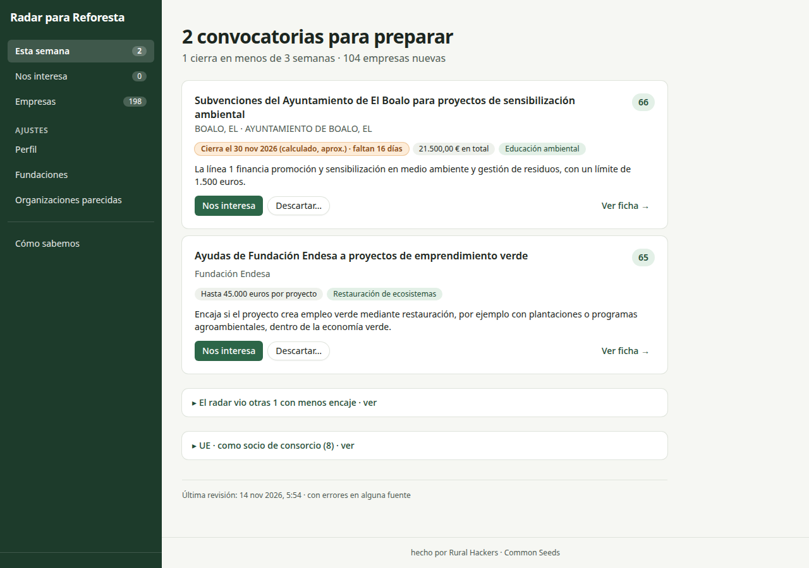
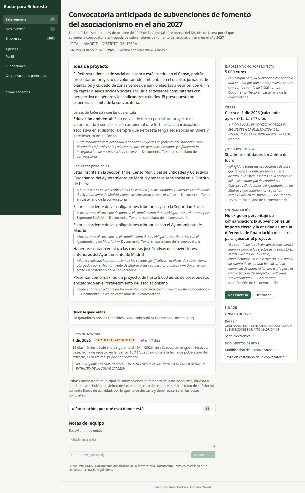
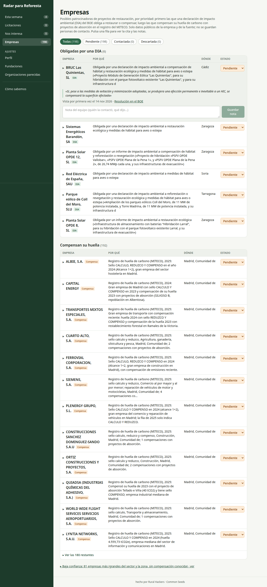
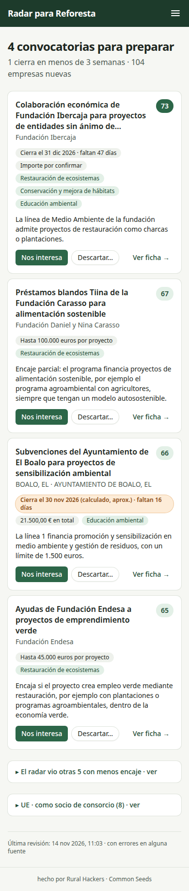

# Radar Reforesta

**Cada lunes, en dos minutos, saber a qué convocatorias y empresas merece la pena dedicar la semana, y por qué.** Radar de financiadores para [Reforesta](https://reforesta.es), hecho para el reto [1hack A Coruña · Common Seeds](https://common-seeds.theagilemonkeys.com/onehack). Código abierto (MIT).



> English summary at the [end](#english-summary).

## El problema

Reforesta es una ONG de restauración ecológica con más de 30 años y 6–7 personas. Presenta unas **4–5 solicitudes al año**, encontradas «en Google o mirando las mismas cuatro fuentes». Alrededor del **90 % de sus ingresos son privados** (2023: donaciones 343.461 €, servicios 105.008 €, subvenciones 58.161 €) y el canal de empresas (RSC) está **a cero**: solo llegan las que se acercan solas. No les falta capacidad de redactar, sino de **encontrar y priorizar**. El Radar no redacta propuestas ni presenta solicitudes: busca, filtra, ordena y explica por qué.

## Qué hace

El flujo de un lunes:

1. De madrugada, el radar ya ha recogido convocatorias nuevas y señales de empresas de las fuentes públicas.
2. A las 8:00 llega un **correo corto** con lo destacado, lo que cierra pronto y lo que ganan organizaciones parecidas.
3. En la **web**, «Esta semana» abre con una frase («N convocatorias para preparar, M cierran en menos de 3 semanas, K empresas nuevas») y unas pocas tarjetas: título corto, cierre en días, importe y una frase de por qué encaja. Lo que queda bajo el corte de encaje está plegado, no escondido.
4. La **ficha** de cada convocatoria enseña importe, plazo y requisitos, cada uno con su **cita literal** y enlace al documento; qué ganó Reforesta en ediciones anteriores y quién ganó el resto; y la puntuación desglosada.
5. El equipo pulsa **Nos interesa** o **Descartar** (con motivo) y el radar aprende de esas decisiones.

| Ficha de una convocatoria | Empresas (tabla tipo CRM) | Móvil |
|---|---|---|
|  |  |  |

**Fuentes de convocatorias**

- **BDNS**, la Base de Datos Nacional de Subvenciones.
- **EU Funding & Tenders** (LIFE, Erasmus+…). Horizon Europe va en una sección aparte, «UE como socio de consorcio»: una ONG de 7 personas solo puede ir de socia.
- **UE · en cascada** (FSTP): convocatorias que abren proyectos europeos (Horizon, LIFE, Digital Europe…) para dar subvenciones pequeñas a terceros. Una entidad sola puede presentarse, sin consorcio, y van en el ranking principal con el chip «UE · en cascada». El pre-filtro de tema (palabras clave, amplio a propósito) está en `seed/cascada.json`, ampliable con `RADAR_TERMINOS_CASCADA`.
- **Licitaciones públicas** (Plataforma de Contratación del Sector Público): contratos de servicios y obras que Reforesta podría ejecutar (restauración, plantación, ailanto, charcas, educación ambiental, mantenimiento forestal), con su **propia página «Licitaciones»**, su contador en el menú y su propia puntuación (encaje, escala del presupuesto, plazo de ofertas, solvencia exigida, peso del precio); en «Esta semana» solo una línea que enlaza a ella. Lee el feed ATOM de datos abiertos con pre-filtro en código (`seed/licitaciones.json`), criba con el criterio «¿puede ejecutarlo una ONG de este tamaño?» (más de 300.000 € sin IVA = «probablemente fuera de escala»; el umbral está en el perfil) y análisis con citas de solvencia, criterios de adjudicación y reserva social. Una pasada diaria son unas 10 páginas de ~14 MB: tiene topes y una cobertura continua sin huecos perdidos (`npm run licitaciones` rellena hacia atrás una vez).
- **Fundaciones vigiladas** (Montemadrid, Repsol…): páginas que se editan desde la web; solo se llama al modelo cuando la página cambia.
- **Descubrimiento por organizaciones parecidas** (GREFA, Grupo Brinzal, SEO/BirdLife…): si lo que ganaron desde 2022 tiene una edición nueva, entra como candidata.

**Canal de empresas (RSC)**: empresas con un motivo verificable para financiar restauración, no una lista fría. (1) Las **declaraciones de impacto ambiental (DIA) del BOE** que obligan a una empresa a restaurar o compensar hábitat; (2) el **registro de huella de carbono** del MITECO (nivel A: compensan, con motivo concreto; nivel B: gran empresa afín de la zona, baja confianza, oculto por defecto).

## Cómo decide

Pasa por embudo, de lo barato a lo caro, y cada paso deja rastro:

1. **Reglas en código**: descartan nominativas y concesiones directas, finalidades ajenas y lo que cae fuera del ámbito.
2. **Criba** (Claude Haiku) sobre los textos que ya trae la fuente: «puede encajar» o «descartar» con motivo.
3. **Análisis con citas literales** (Claude Sonnet) de bases y documentos: elegibilidad para entidades sin ánimo de lucro, importe, plazo, cofinanciación, requisitos e idea de proyecto. El código comprueba que cada cita está en el texto; si no, el dato queda como *desconocido*. **Nunca inventa importes ni plazos.**
4. **Plazos en días hábiles**, calculados en código (sin modelo) con festivos nacionales y por región; si el texto es ambiguo, se muestra tal cual.
5. **Puntuación 0–100 explicable**, también en código: encaje, importe, tiempo hasta el cierre, esfuerzo y probabilidad, todos visibles en la ficha. Un dato que falta vale neutro y se dice.
6. **Corte**: «Esta semana» solo enseña lo analizado con puntuación igual o superior al umbral del perfil (50 por defecto), máximo 7.

**Ámbito por territorios.** Cuenta dónde se *ejecuta* el proyecto: Madrid y sus provincias limítrofes (Segovia, Ávila, Guadalajara, Toledo, Cuenca). Estatales y de la UE valen siempre. Además, el perfil guarda el **domicilio** de la entidad (Tres Cantos) y el análisis **descarta lo que exige sede o inscripción en otro sitio**.

## Cómo sabemos que funciona

La página pública `/como-sabemos` (en la web; [captura](docs/capturas/como-sabemos-escritorio.png)) lo prueba con datos reales, con la salvedad de que es una **reclasificación con las reglas de hoy, no una reproducción histórica**:

- **6 de 6 convocatorias conocidas detectadas**: la convocatoria anual de la Comunidad de Madrid a la que se presenta Reforesta (ediciones 2022–2026) y la de MITECO 923290 pasan reglas y criba.
- **23 de 25 (92 %)** de las convocatorias ganadas desde 2022 por organizaciones parecidas pasan la criba (de 308 examinadas, 25 cumplen las reglas objetivas).
- **Advertencia: ese 92 % no es una precisión.** El conjunto está prefiltrado por palabras clave, no tiene control negativo y se juzga con los documentos y el perfil de hoy. Tampoco hay aún una medición de falsos negativos.

Sobre el historial de Reforesta, solo lo verificado en BDNS: ganó las convocatorias 626301, 782630 y 825309; en la 703977 «no figura entre los ganadores» (BDNS publica ganadores, no quién perdió); la 904719 está pendiente de resolver.

## Vídeo y demo

- [Vídeo de la demo](https://youtu.be/lqEiin8vH50)
- Demo en vivo: **https://reforesta.ruralhackers.com** — acceso con código por email (Cloudflare Access); pide acceso si no estás en la lista.

El vídeo se genera con `npm run video` (guion en [`docs/guion-video.md`](docs/guion-video.md)); las capturas de este README, con `npm run capturas` ([`docs/capturas/`](docs/capturas/LEEME.md)).

## Probarlo en local

Requisitos: **Node 24** y una clave de la API de Anthropic.

```sh
npm ci
cp .env.example .env        # y pon ANTHROPIC_API_KEY=... (única variable obligatoria)
LOOKBACK_DAYS=60 RADAR_MAX_ANALISIS=10 npm run radar   # primera carga: unos 60 días, 10 análisis (el perfil se siembra solo desde seed/perfil.json)
npm run build && npm start  # abre http://127.0.0.1:8116
```

Más comandos: `npm test` (respuestas reales grabadas), `npm run digest -- --vista-previa` (escribe `data/digest-preview.html` sin enviar nada), `npm run cargar -- 904719` (mete una convocatoria concreta de BDNS por su número), `npm run licitaciones -- --paginas 40` (relleno puntual del feed de licitaciones, ~14 MB por página), `npm run dev:web` (web con recarga). Sin `ANTHROPIC_API_KEY` el radar se salta criba y análisis y lo apunta en el registro (`/api/ejecuciones`), y «Esta semana» queda vacía. Con Docker: `docker compose up -d`.

## Desplegar

Un solo contenedor Docker con `compose.yaml`, la web solo en `127.0.0.1` y un túnel de Cloudflare (o nginx) delante; cron para el radar diario y el correo del lunes. Los datos son un único fichero SQLite en `data/`, con copia diaria.
Paso a paso, con los comandos exactos: [`deploy/PASOS.md`](deploy/PASOS.md) (`deploy/desplegar.sh`, `deploy/instalar-cron.sh`, plantilla [`deploy/.env.produccion.example`](deploy/.env.produccion.example)).

## Configuración

Solo `ANTHROPIC_API_KEY` es obligatoria; el resto tiene valor por defecto ([`src/config.ts`](src/config.ts), comentadas en [`.env.example`](.env.example)). Los numéricos se validan al arrancar: vacío = defecto; no numérico o negativo = error.

| Variable | Obligatoria | Por defecto | Para qué |
|---|---|---|---|
| `ANTHROPIC_API_KEY` | **sí** | — | Clave de la API de Claude (sin ella no hay criba ni análisis) |
| `RADAR_PRESUPUESTO_USD` | no | `1.00` | Techo de gasto de LLM por ejecución, común a todas las fases |
| `RADAR_MAX_ANALISIS` | no | `20` | Máximo de análisis (Sonnet) por ejecución |
| `LOOKBACK_DAYS` | no | `7` | Días hacia atrás que revisa cada pasada |
| `RADAR_MODELO_CRIBA` / `RADAR_MODELO_ANALISIS` | no | `claude-haiku-5-5` / `claude-sonnet-5-5` | Modelos |
| `TEAM_PASSWORD` | no | vacío = demo pública | Activa el modo privado |
| `SESSION_SECRET` | recomendada con `TEAM_PASSWORD` | — | Firma de la cookie (`openssl rand -hex 32`) |
| `RADAR_COOKIE_SECURE` | no | según https | `1` tras el túnel |
| `RESEND_API_KEY` | solo para el correo | — | Envío del correo del lunes |
| `RADAR_DIGEST_DESTINATARIOS` | solo para el correo | vacío = no se envía | Destinatarios, separados por comas |
| `RADAR_DIGEST_REMITENTE` | no | `Radar Reforesta <no-reply@out.ruralhackers.com>` | Debe ser un dominio verificado en Resend |
| `RADAR_URL_PUBLICA` | para enviar el correo | ninguno | URL pública de tu instancia, para los enlaces del correo |
| `PORT` | no | `8116` | Puerto |
| `DB_PATH` | no | `data/radar.sqlite` | Fichero SQLite |
| `SEED_FILE`, `FESTIVOS_FILE`, `PUNTUACION_FILE` | no | `seed/perfil.json`, `seed/festivos.json`, `seed/puntuacion.json` | Semillas |

Las variables de cada fuente (topes de peticiones, pausas, días de caché) están en la [tabla completa](docs/referencia-tecnica.md#variables-de-entorno).

## Coste

Solo se paga la API de Claude (Haiku 5.5: 0,10 / 0,50 USD por millón de tokens de entrada/salida; Sonnet 5.5: 2 / 10). Cifras medidas en ejecuciones reales:

- Criba de una pasada completa con BDNS + UE (148 convocatorias): **0,075 USD**.
- Análisis con citas: **≈ 0,15 USD** cada uno.
- Empresas: DIA del BOE (60 días) 0,063 USD la primera vez; huella de carbono 0,018 USD.
- Backtest completo: 0,014 USD.

Todo se cachea: repetir una pasada sin novedades cuesta 0 USD. Estimación en régimen (no medida a un mes completo): **unos 3–10 USD al mes**. Techo duro: `RADAR_PRESUPUESTO_USD` por ejecución (1 USD por defecto, una ejecución al día: peor caso ≈ 30 USD/mes); al agotarse, lo que falta queda para la siguiente. Detalle en la [referencia técnica](docs/referencia-tecnica.md#coste-mensual-estimado).

## Privacidad

Sin `TEAM_PASSWORD` todo es público y editable (modo demo). Con ella, **siguen públicos** «Esta semana», fichas, «Cómo sabemos», perfil, parecidas, fundaciones y empresas (sin estado ni nota); **piden contraseña** todas las escrituras y lo que el equipo lee de su propio trabajo (decisiones, «Nos interesa», notas, estado de empresas). Las respuestas públicas nunca incluyen decisiones ni notas. Los datos vienen de fuentes públicas; no se guardan personas de contacto. Detalle (fuerza bruta, Cloudflare Access) en la [referencia técnica](docs/referencia-tecnica.md#modo-privado).

## Adaptarlo a otra ONG

Todo lo específico de Reforesta está en [`seed/`](seed/), no en el código: `perfil.json` (nombre, domicilio, líneas, ámbito por territorios, importe mínimo, umbral del corte, fundaciones vigiladas y organizaciones parecidas por NIF), `puntuacion.json` (pesos y umbrales), `festivos.json`. El perfil se siembra la primera vez y después se edita en la web. Pasos y detalles en la [referencia técnica](docs/referencia-tecnica.md#adaptarlo-a-otra-ong).

## Límites conocidos

- BDNS solo tiene concesiones desde 2022 y solo publica ganadores: «no figura entre los ganadores» no significa «perdió».
- La probabilidad de éxito es débil (pocas ediciones); sin historial es neutra.
- El backtest no es una validación estadística (6 + 25 casos, sin control negativo, sin medir falsos negativos).
- Sin el análisis, la puntuación es parcial; los plazos ambiguos se muestran sin calcular y no incluyen fiestas locales.
- Algunas webs de fundaciones bloquean a clientes automáticos (p. ej. «la Caixa», desactivada en la semilla); la lista es corta.
- Licitaciones: el feed de la Plataforma pesa ~14 MB por página y la primera carga cubre unas dos jornadas; las plataformas agregadas no se pueden leer (piden certificado) y la Plataforma rechaza a veces la descarga automática de los pliegos PDF («Request Rejected»), así que el análisis se apoya entonces en los datos estructurados del anuncio.
- Empresas: las DIA dan un motivo verificable, no un contacto; el nivel B de la huella es de baja confianza.
- Un único usuario «equipo», sin cuentas individuales. No redacta propuestas ni presenta solicitudes.
- Pendientes: el correo del lunes aún no sigue el rediseño de la web.

Lista completa en la [referencia técnica](docs/referencia-tecnica.md#límites-conocidos).

## Créditos y licencia

[MIT](LICENSE). Hecho por [Rural Hackers](https://ruralhackers.com) para [Reforesta](https://reforesta.es) en el reto 1hack A Coruña de [Common Seeds](https://common-seeds.theagilemonkeys.com/onehack) (The Agile Monkeys). Datos de BDNS (IGAE), el portal Funding & Tenders de la Comisión Europea, la Plataforma de Contratación del Sector Público (datos abiertos), el BOE (datos abiertos) y el Registro de huella de carbono del MITECO. Diseño: [`docs/superpowers/specs/`](docs/superpowers/specs/); vocabulario: [`GLOSSARY.md`](GLOSSARY.md); detalle técnico: [`docs/referencia-tecnica.md`](docs/referencia-tecnica.md).

## English summary

**Radar Reforesta** is an open-source (MIT) funding radar built for Reforesta, a Spanish ecological-restoration NGO with 6–7 staff that files only 4–5 applications a year and gets about 90 % of its income from private sources, with its corporate (CSR) channel at zero. Their bottleneck is not writing but *finding and prioritising*. Every day the radar collects calls from Spain's national subsidies database (BDNS), EU Funding & Tenders (Horizon Europe shown separately, as consortium partner), a watch-list of foundations, and from what similar NGOs have won since 2022. It also surfaces companies with a verifiable reason to fund restoration: environmental impact declarations in the official gazette and the national carbon-footprint registry. A cheap screening step (Claude Haiku) and a cited analysis (Claude Sonnet) read each call; every amount, deadline and requirement carries a literal quote, deadlines are computed in code in working days, and unknown data is never invented. Calls requiring a seat elsewhere are excluded, and scope is set by territory (Madrid and neighbouring provinces). A transparent 0–100 score ranks what is worth the effort; a threshold cut keeps the Monday view short, on a web app and a weekly e-mail. A public "How we know" page backtests it: 6 of 6 known calls detected, and 23 of 25 calls won by similar organisations pass screening (explicitly not a precision figure). Running cost is roughly 3–10 USD per month, capped per run. Run it with `npm ci`, `npm run radar`, `npm run build && npm start`; adapt it to another NGO by editing `seed/`. UI and prompts are in Spanish.
