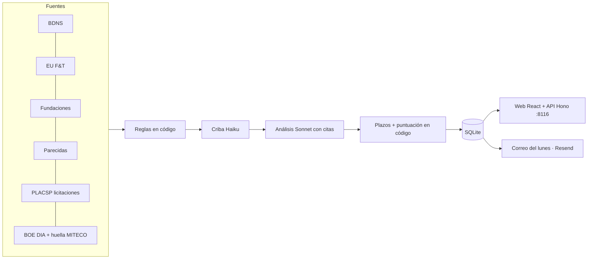

# Referencia técnica

Detalle operativo y módulo por módulo del Radar Reforesta, tal como funciona hoy. Para la visión general, la instalación rápida y los
números del reto, ver el [README](../README.md); vocabulario en [`GLOSSARY.md`](../GLOSSARY.md); rediseño de la web en
[`superpowers/specs/2026-11-14-rediseno-web-design.md`](superpowers/specs/2026-11-14-rediseno-web-design.md).

## Qué hace

Cada día recoge convocatorias y señales de empresas, decide cuáles encajan con el perfil de Reforesta, las ordena con una puntuación
explicable y lo enseña en una **web** (que se puede abrir desde el primer día) y en un **correo cada lunes a las 8:00**.

| Canal | Fuentes |
|---|---|
| Subvenciones públicas | BDNS (Base de Datos Nacional de Subvenciones) y EU Funding & Tenders (LIFE, Horizon Europe, Erasmus+…) |
| Licitaciones | Contratos públicos de servicios y obras (restauración, plantación, invasoras, charcas, educación ambiental, mantenimiento forestal) de la Plataforma de Contratación del Sector Público (PLACSP), en su propia página y puntuación |
| Fundaciones y RSC | Páginas de convocatorias de fundaciones privadas vigiladas (Montemadrid, Repsol, Iberdrola, BBVA…; editable desde la web). Solo se llama al LLM cuando la página cambia |
| Descubrimiento | Lo que han ganado desde 2022 organizaciones parecidas a Reforesta (GREFA, Grupo Brinzal, SEO/BirdLife…): si su serie tiene una edición nueva, entra como candidata |
| Empresas | (1) Declaraciones de impacto ambiental del BOE que obligan a una empresa a restaurar o compensar hábitat; (2) Registro de huella de carbono del MITECO, en dos niveles: A (compensan, motivo concreto) y B (gran empresa afín de la zona, baja confianza, oculto por defecto) |

Por cada convocatoria: criba barata (Claude Haiku) y análisis con **cita literal** de importe, plazo y requisitos (Claude Sonnet). Lo que
no consta se marca como *desconocido*, nunca se inventa. Además: plazos de cierre calculados en código (con festivos), ganadores
previos de la misma línea, decisiones y notas del equipo ("Nos interesa", "Descartar" con motivo; el radar aprende de ellas) y la
página `/como-sabemos` con el backtest.

## Cómo prioriza

Cada candidata en juego recibe una puntuación **0–100 explicable**, calculada en código (sin LLM) con cinco factores visibles en la
ficha ("Por qué está donde está"): **encaje** con las líneas de Reforesta, **importe**, **tiempo hasta el cierre**, **esfuerzo**
(cofinanciación, requisitos) y **probabilidad** (ediciones ganadas por Reforesta y por organizaciones parecidas). Un dato que falta no
cuenta como bueno: vale un valor neutro y la explicación dice "desconocido". Pesos y umbrales en `seed/puntuacion.json`.

"Esta semana" muestra solo las analizadas con puntuación igual o superior al umbral del perfil (`umbralEncaje`, 50 por defecto), como mucho 7;
el resto queda plegado en "El radar vio otras N con menos encaje", y los consorcios de la UE en su propia sección plegada. Hay además una
lista paralela "Las ganan organizaciones como vosotros". Detalle en [Puntuación y ranking](#puntuación-y-ranking).

## Cómo sabemos que funciona

Página pública `/como-sabemos` (resultados en `seed/backtest.json`, `npm run backtest`). Dos pruebas, con la advertencia de que es una
**reclasificación con las reglas de hoy, no una reproducción histórica**:

- **(a) Convocatorias conocidas: 6 de 6 detectadas.** La convocatoria anual de la Comunidad de Madrid a la que se presenta Reforesta
  (ediciones 2022–2026, 5 filas, con la Orden 1689/2026 del reto = edición 2026) y la convocatoria de MITECO 923290 pasan reglas y criba, de modo
  que aparecerían en "Esta semana". La puntuación se muestra como dato, no como criterio de éxito (sin análisis, 38–47 sobre un máximo
  de ~47: depende sobre todo de si el plazo es conocido).
- **(b) Descubrimiento: 23 de 25 (92 %) pasan la criba.** Son convocatorias ganadas desde 2022 por organizaciones parecidas (de 308
  examinadas, 25 cumplen las reglas objetivas: no nominativas ni de concesión directa, ámbito del perfil, finalidad ambiental, admiten
  entidades sin ánimo de lucro, sin las ganadas por Reforesta). Reforesta no figura entre sus ganadores (BDNS no publica quién perdió).
  **Ese porcentaje no es una precisión**: el conjunto está prefiltrado por palabras clave, no tiene control negativo y se juzga con los
  documentos y el perfil de hoy.

Coste del backtest completo en una pasada real: 31 llamadas a Haiku, 0,014 USD.

## Arquitectura



Node 24 (TypeScript sin compilar), SQLite (`node:sqlite`), Hono para la API, Vite + React para la web, Anthropic SDK. Un solo contenedor
Docker; un cron diario ejecuta `npm run radar` y otro, los lunes, `npm run digest`.

## Arrancar en local

Requiere Node 24 o Docker.

```sh
npm install
cp .env.example .env     # y rellena ANTHROPIC_API_KEY (ver tabla de variables)
npm run radar            # una pasada: fuentes → reglas → criba → análisis → plazos → puntuación → SQLite (data/radar.sqlite)
npm run build            # compila la web (dist/web)
npm start                # web + API en http://127.0.0.1:8116
npm test                 # node --test (respuestas reales grabadas de BDNS, UE, BOE, fundaciones y MITECO)
npm run digest -- --vista-previa   # escribe data/digest-preview.html sin enviar nada
npm run cargar -- 904719           # mete convocatorias concretas de BDNS por su número (ver abajo)
npm run licitaciones -- --paginas 40   # relleno puntual hacia atrás del feed de licitaciones (PLACSP; ver «Fuente PLACSP»)
```

**Cargar una convocatoria concreta.** `npm run cargar -- <numeroConvocatoria> [...]` pide a BDNS el detalle de esas convocatorias (aunque sean
antiguas o ya estén cerradas) y las pasa por el camino normal: reglas → criba (Haiku) → ganadores previos de su serie → análisis (Sonnet, con
`RADAR_MAX_ANALISIS` y `RADAR_PRESUPUESTO_USD`) → plazo → puntuación. Así tienen ficha en `/convocatoria/bdns:<número>`, con quién ganó cada
edición y si la ganó Reforesta. Solo procesa esas (lo pendiente de otras fuentes queda para la pasada diaria). Útil para revisar una convocatoria
que alguien ha visto fuera del radar, o para preparar una demo: `RADAR_MAX_ANALISIS=0 npm run cargar -- 904719` cuesta unos céntimos (solo la criba)
y deja la ficha con las ediciones 2022–2025, sus ganadores y las fechas de apertura de cada edición (para la predicción de la siguiente). En Docker: `docker compose run --rm radar npm run cargar -- 904719`.

Con Docker:

```sh
docker compose up -d                          # web + API en http://127.0.0.1:8116
docker compose run --rm radar npm run radar   # una pasada del radar
```

Sin `ANTHROPIC_API_KEY` el radar se salta la criba y el análisis y lo apunta en el registro de la ejecución (`/api/ejecuciones`), donde
también queda el coste de LLM de cada fase. Sin criba, «Esta semana» y el correo quedan vacíos: solo entra en el ranking lo que ya pasó la criba LLM (sin veredicto, una convocatoria puntuaba 47 solo con el cierre conocido). El perfil de Reforesta se carga de `seed/perfil.json` la primera vez y después se edita en
la web. `npm run record:*` regraba los datos de prueba (BDNS, concesiones, parecidas, UE, fundaciones, BOE, huella).

## Despliegue

Servidor propio con Docker, una carpeta con `compose.yaml` y `.env`, la web solo en `127.0.0.1` y expuesta por un túnel de Cloudflare
(o un nginx con TLS); cron (radar diario 07:00, copia de la BD 06:45, resumen los lunes 08:00 con reintento los martes, hora de Madrid). Paso a paso, con los comandos exactos,
en [`deploy/PASOS.md`](../deploy/PASOS.md) (`deploy/desplegar.sh`, `deploy/instalar-cron.sh`, `deploy/crontab.txt`). Antes de nada,
rellena el `.env` a partir de [`deploy/.env.produccion.example`](../deploy/.env.produccion.example). Los datos son un único fichero SQLite
(`data/radar.sqlite`, bind mount, en modo WAL). La copia de seguridad es la que el cron hace cada día con `VACUUM INTO` en
`data/backup/radar-N.sqlite` (una por día de la semana): no copies `radar.sqlite` en caliente, porque lo último puede estar aún en `-wal`.
Cómo restaurar, en `deploy/PASOS.md`.

## Variables de entorno

Solo hay una obligatoria. Todas las demás tienen valor por defecto (en `src/config.ts`); `.env.example` las lista comentadas. Los valores
numéricos se comprueban al arrancar: vacío = valor por defecto; un valor no numérico, negativo o fuera de rango para el proceso con un mensaje
claro (código 1), en vez de quitar un tope sin avisar.

| Variable | Obligatoria | Por defecto | Para qué |
|---|---|---|---|
| `ANTHROPIC_API_KEY` | **sí** (sin ella no hay criba ni análisis ni empresas con LLM) | — | Clave de la API de Claude |
| `RESEND_API_KEY` | solo para el correo | — | Envío del resumen semanal |
| `RADAR_DIGEST_DESTINATARIOS` | solo para el correo | vacío = no se envía | Destinatarios, separados por comas |
| `RADAR_DIGEST_REMITENTE` | no | `Radar Reforesta <no-reply@out.ruralhackers.com>` (cámbialo: debe ser un dominio verificado en Resend) | Remitente |
| `RADAR_URL_PUBLICA` | **sí, para enviar el correo** | ninguno: sin ella `npm run digest` no envía (error claro) y la vista previa usa enlaces relativos | URL pública de **tu** instancia (p. ej. `https://radar.tu-dominio.org`), para los enlaces del correo |
| `TEAM_PASSWORD` | no | vacío = demo pública | Activa el modo privado (ver abajo) |
| `SESSION_SECRET` | recomendada con `TEAM_PASSWORD` | — | Secreto aleatorio (`openssl rand -hex 32`) que firma la cookie |
| `RADAR_COOKIE_SECURE` | no | según https / `X-Forwarded-Proto` | `1` tras el túnel (la app ve http local) |
| `RADAR_CONFIAR_X_FORWARDED_FOR` | no | vacío | `1` solo tras un proxy propio que fije la cabecera |
| `PORT` | no | `8116` | Puerto publicado (compose lo enlaza a 127.0.0.1) |
| `TZ` | no | `Europe/Madrid` (fijado en `compose.yaml`) | Zona horaria del contenedor |
| `DB_PATH` | no | `data/radar.sqlite` | Fichero SQLite |
| `SEED_FILE`, `FESTIVOS_FILE`, `PUNTUACION_FILE` | no | `seed/perfil.json`, `seed/festivos.json`, `seed/puntuacion.json` | Semillas (ver "Adaptarlo a otra ONG") |
| `LOOKBACK_DAYS` | no | `7` | Días hacia atrás que revisa cada pasada |
| `RADAR_MODELO_CRIBA`, `RADAR_MODELO_ANALISIS` | no | `claude-haiku-5-5`, `claude-sonnet-5-5` | Modelos |
| **`RADAR_PRESUPUESTO_USD`** | no | `1.00` | **Techo de gasto de LLM por ejecución, común a todas las fases** (criba, análisis, fundaciones, DIA, huella); cuentan también las llamadas que fallan tras cobrarse. Al llegar, lo que falta queda para la siguiente |
| **`RADAR_MAX_ANALISIS`** | no | `20` (igual en la producción de ejemplo) | **Tope de análisis (Sonnet) por pasada** |
| `RADAR_MAX_CARACTERES_ANALISIS` | no | `300000` | Caracteres de documentos que entran como máximo en un análisis (el resto se recorta con una nota) |
| `RADAR_MAX_INTENTOS_LLM` | no | `3` | Intentos fallidos del LLM (respuesta cortada, rechazo, JSON no válido) tras los que una convocatoria deja de reintentarse |
| `RADAR_DIAS_PENDIENTES` | no | `30` | Días en que se reintentan criba y análisis pendientes |
| `RADAR_EJEMPLOS_DECISIONES` | no | `20` | Decisiones del equipo que van como ejemplos a los prompts |
| `RADAR_DIAS_CACHE_GANADORES`, `RADAR_MAX_PETICIONES_GANADORES`, `RADAR_PAUSA_BDNS_MS` | no | `7`, `200`, `250` | Concesiones de BDNS: caché, tope de peticiones y pausa |
| `RADAR_MAX_PETICIONES_PARECIDAS`, `RADAR_DESDE_ANIO_PARECIDAS`, `RADAR_DIAS_EDICION_PARECIDAS` | no | `100`, `2022`, `400` | Descubrimiento por parecidas |
| `RADAR_PAUSA_FT_MS`, `RADAR_MAX_PETICIONES_FT` | no | `500`, `8` | EU Funding & Tenders |
| `RADAR_LICITACIONES`, `RADAR_MAX_PAGINAS_PLACSP`, `RADAR_MAX_BYTES_PLACSP`, `RADAR_MAX_BYTES_TOTAL_PLACSP`, `RADAR_PAUSA_PLACSP_MS`, `RADAR_TIMEOUT_PLACSP_MS` | no | `1` (`0` apaga la fuente), `12`, `20971520`, `314572800`, `2000`, `120000` | Licitaciones (PLACSP): tope de páginas del feed por pasada (~500 entradas y ~14 MB cada una), de bytes por página y totales, pausa y tiempo máximo |
| `RADAR_DIAS_HUECO_PLACSP`, `RADAR_MAX_HUECOS_PLACSP` | no | `14`, `10` | Licitaciones: días tras los que se abandona un hueco sin leer del feed y máximo de huecos guardados |
| `RADAR_CPV_PLACSP`, `RADAR_TERMINOS_PLACSP`, `PLACSP_FILE`, `PLACSP_URL` | no | vacío, vacío, `seed/licitaciones.json`, el feed 643 | CPV y palabras extra del pre-filtro de licitaciones (separados por comas), fichero del pre-filtro y URL del feed |
| `RADAR_PAUSA_FUNDACIONES_MS`, `RADAR_TIMEOUT_FUNDACIONES_MS`, `RADAR_MAX_BYTES_FUNDACIONES`, `RADAR_MAX_FUNDACIONES`, `RADAR_MAX_CARACTERES_FUNDACIONES` | no | `1000`, `30000`, `3145728`, `60`, `60000` | Fundaciones vigiladas |
| `RADAR_DIAS_DIA_BOE`, `RADAR_MAX_DIA_BOE`, `RADAR_PAUSA_BOE_MS`, `RADAR_MAX_CARACTERES_DIA_BOE` | no | `60`, `40`, `300`, `150000` | Empresas desde las DIA del BOE |
| `RADAR_MAX_HUELLA`, `RADAR_SECTORES_HUELLA`, `RADAR_ANIOS_HUELLA`, `RADAR_TIMEOUT_HUELLA_MS` | no | `50`, `B,D,E,F,G,H`, `3`, `60000` | Registro de huella de carbono |
| `BACKTEST_DB`, `BACKTEST_MAX_B`, `BACKTEST_MAX_DETALLES_B`, `BACKTEST_FILE` | no | `data/backtest/trabajo.sqlite`, `150`, `400`, `seed/backtest.json` | Backtest "Cómo sabemos" |

## Modo privado

Sin `TEAM_PASSWORD` todo es público y editable: es el modo demo. Con ella (cookie firmada de 180 días; cambiar la contraseña la invalida):

- **Se ve sin entrar** (solo lectura): "Esta semana", fichas de convocatorias, descartes del motor, ejecuciones, "Cómo sabemos", el perfil,
  la lista de organizaciones parecidas, la lista de fundaciones vigiladas y las empresas (sin su estado ni la nota del equipo).
- **Pide contraseña**: todo lo que escribe (decisiones, notas, editar el perfil, activar/añadir/quitar parecidas y fundaciones, estado y nota
  de empresas) y todo lo que el equipo lee de su propio trabajo (`/api/equipo/*`: decisiones, "Nos interesa", notas, empresas con estado y nota,
  y el filtro por estado de empresas).

Las respuestas públicas nunca incluyen decisiones, notas ni el estado de las empresas; lo descartado por el equipo se oculta de "Esta semana"
para todos. Pon también `SESSION_SECRET` y, tras el túnel, `RADAR_COOKIE_SECURE=1`. Detalle (fuerza bruta, CSRF) en
[Modo privado (`TEAM_PASSWORD`)](#modo-privado-team_password).

**Demo abierta y gasto.** En modo demo cualquiera puede editar el perfil o añadir fundaciones, y eso hace que la siguiente pasada vuelva a cribar
o analizar. El gasto lo acota igualmente `RADAR_PRESUPUESTO_USD` (por defecto 1 USD por ejecución, una al día): un cambio de perfil solo rehace
los veredictos de los últimos 30 días y nunca borra los anteriores.

**Alternativa: Cloudflare Access.** Si la web va tras Cloudflare Tunnel, puedes dejar `TEAM_PASSWORD` vacío y proteger todo el
hostname con una aplicación de Cloudflare Access (Zero Trust > Access > Applications, política por correo o dominio de la
organización). Así el login lo gestiona Cloudflare (correo con código, Google…) y la app no guarda ninguna contraseña; a cambio, la
web deja de ser pública (tampoco "Cómo sabemos"), y el equipo es "todo el que pase Access".

**Aviso sobre `CF-Connecting-IP`.** El límite de intentos fallidos por IP se apoya en esa cabecera, que la app acepta sin más porque
el puerto está en `127.0.0.1` y solo se llega por el túnel (que la fija). Si expones el puerto directamente, se puede falsificar y el
límite se esquiva: no lo expongas, o ponlo tras un proxy que la sobrescriba. Y al revés: 10 fallos desde una misma IP/NAT bloquean
durante 15 minutos hasta la contraseña correcta.

## Coste mensual estimado

Solo hay coste de la API de Claude (Haiku 5.5: 0,10 / 0,50 USD por millón de tokens de entrada/salida; Sonnet 5.5: 2 / 10) y, si se
quiere, Resend (el plan gratuito sobra para un correo semanal). Cifras de **ejecuciones reales** (informes de las tareas 2, 11–15):

| Pieza | Coste medido |
|---|---|
| Criba (Haiku) de una pasada completa con BDNS + UE: 148 convocatorias | 0,075 USD (la pasada entera, con la extracción de fundaciones, 0,082 USD) |
| Análisis con citas (Sonnet) | ≈ 0,15 USD cada uno (0,145 USD de media; las bases largas lo suben) |
| Empresas, DIA del BOE (60 días, 18 resoluciones leídas) | 0,063 USD la primera vez |
| Empresas, huella de carbono (79 llamadas) | 0,018 USD |
| Backtest completo (31 llamadas) | 0,014 USD |

Todo se cachea (respuestas del LLM por contenido, huella de las páginas, resoluciones ya leídas): repetir una pasada sin novedades cuesta
0 USD, así que **ejecutando a diario solo se paga lo nuevo**. Estimación (no medida a un mes completo): criba y empresas, **1–3 USD/mes**;
análisis, unos 10–40 al mes (lo que pasa la criba y es nuevo) = **1,5–6 USD/mes**. Total en régimen: **unos 3–10 USD al mes**.
La primera pasada sobre una BD vacía es mayor (hasta 20–60 análisis pendientes = 3–9 USD, repartidos en varias pasadas por el tope).

**Cómo acotarlo (peor caso):** el techo duro es **`RADAR_PRESUPUESTO_USD`** (1 USD por defecto), que comparten todas las fases con LLM de
una ejecución y que cuenta también las llamadas que fallan después de cobrarse (respuesta cortada, rechazo, JSON no válido). Con una ejecución
diaria, **el peor caso es 1 × 30 ≈ 30 USD/mes** (algo más si las últimas llamadas en vuelo terminan tras alcanzarlo: como mucho unas pocas
llamadas por fase). Además: `RADAR_MAX_ANALISIS` (20) limita cuántos análisis de Sonnet hace una pasada; cada análisis lleva como mucho
`RADAR_MAX_CARACTERES_ANALISIS` (300.000) caracteres de documentos, unos 0,2–0,3 USD en el peor caso; y una convocatoria que hace fallar al LLM
se reintenta como mucho `RADAR_MAX_INTENTOS_LLM` (3) veces en total. Para un tope más estricto, baja el presupuesto (p. ej. 0,30 → máximo
≈ 9 USD/mes) o ejecuta el radar menos veces. `RADAR_MAX_DIA_BOE` y `RADAR_MAX_HUELLA` limitan las lecturas de empresas, y `/api/ejecuciones`
muestra el coste real de cada pasada por fase.

## Adaptarlo a otra ONG

Todo lo específico de Reforesta está en `seed/`, no en el código:

- `seed/perfil.json`: perfil (nombre, NIF, líneas, ámbito, importe mínimo…), `fundaciones` vigiladas y `organizacionesParecidas` (NIF de entidades que ganan lo mismo que vosotros; se pueden añadir también desde la web). Se carga si la
  BD no tiene perfil (`npm run seed`); después se edita en la página Perfil.
  Al cambiar líneas o ámbito, los veredictos de criba y análisis hechos con el perfil anterior se marcan como obsoletos (no se borran): la
  siguiente pasada rehace solo los de los últimos `RADAR_DIAS_PENDIENTES` días; los más antiguos conservan el veredicto que tenían. El orden
  de las líneas no cuenta.
  **Ámbito de actuación** (`ambito.territorios`): dónde se pueden *ejecutar* los proyectos (lo que importa no es la sede). Por comunidad
  autónoma y con sus provincias admitidas (vacía = toda la comunidad); por defecto Madrid y las provincias limítrofes (Segovia, Ávila, Guadalajara,
  Toledo, Cuenca). Reglas (`src/rules.ts`): estatales (`nivelesSiempre`) y de la UE valen siempre; autonómicas, solo de comunidades con algún
  territorio (si la comunidad solo vale en parte, p. ej. Castilla y León, se descarta si declara solo otras provincias —códigos NUTS3— y si no
  declara ninguna pasa **condicionada**: la criba Haiku comprueba que admita las provincias del ámbito); locales, solo de diputaciones de esas
  provincias o con alguna de las `regiones` NUTS (las provincias y Madrid, que BDNS filtra por código). El prompt dice «El proyecto debe ejecutarse
  en: …» con esa lista, que se edita en la página Perfil. Los perfiles guardados antes (sin `territorios`) los reciben de la semilla al arrancar,
  y las reglas se reaplican a todo lo guardado en cada pasada, así que un cambio de ámbito alcanza también a lo que las fuentes ya no devuelven.
- `seed/puntuacion.json`: pesos y umbrales de la puntuación (el campo `_` lo documenta), `consorcio` (ver «Puntuación y ranking») y `licitaciones` (puntuación de los contratos públicos).
- `seed/licitaciones.json`: CPV y palabras del título del pre-filtro de licitaciones; `perfil.licitaciones` (`presupuestoMaximo`: presupuesto base sin IVA por encima del cual es «probablemente fuera de escala»; `ingresosAnuales`: con lo que se compara el volumen de negocio que piden los pliegos) y `perfil.entidad` (`equipo`, `formaJuridica`: cómo se describe a la entidad en los prompts) fijan lo que puede asumir. Sin esos campos no hay umbral de escala ni de solvencia (no hay valores por defecto en código); los perfiles ya guardados los reciben de la semilla.
- `seed/festivos.json`: festivos nacionales y autonómicos para contar días hábiles (añade el año o la región que falte).
- `seed/backtest.json`: se regenera con `npm run backtest`. Las convocatorias conocidas del conjunto (a) están en `src/backtest/conjuntos.ts`:
  sustitúyelas por las vuestras.

Para otra ONG: cambia el perfil, el NIF (para ver vuestro historial de concesiones en BDNS), las parecidas y las fundaciones, y lanza
una pasada.

## Límites conocidos

- **BDNS solo tiene concesiones desde 2022** y solo publica ganadores: la ficha dice "no figura entre los ganadores", nunca "perdió".
- **La probabilidad es débil**: se apoya en pocas ediciones y en organizaciones parecidas; sin historial propio es neutra.
- **El backtest no es una validación estadística**: 6 conocidas y 25 de descubrimiento, prefiltradas por palabras clave y sin control
  negativo; el 92 % no es una precisión. No hay todavía una medición de falsos negativos.
- **Sin el análisis, la puntuación es parcial** (máximo ~47): importe, encaje y esfuerzo cuentan como desconocidos hasta que Sonnet lee las bases.
- **Los plazos "desconocidos"** (varios plazos en un texto, notificación, semanas…) se muestran con el texto original, no se adivinan. No incluye
  fiestas locales.
- **Fundaciones**: algunas webs bloquean a los clientes automáticos (p. ej. "la Caixa", HTTP 403; en la semilla, desactivada con su nota).
  La lista de la semilla es corta: hay que ir ampliándola desde la web.
- **Empresas**: las DIA dan un motivo verificable pero no un contacto; no se guardan personas ni se leen webs de RSC. El nivel B de la
  huella es de baja confianza.
- **Licitaciones**: el feed de PLACSP son ~14 MB por página y la primera carga solo cubre unas 2 jornadas (`npm run licitaciones` rellena más atrás); las plataformas agregadas (certificado de cliente) no se leen; los PDF de los
  pliegos los rechaza a veces el cortafuegos de la Plataforma («Request Rejected») y entonces el análisis usa solo el anuncio del feed; una licitación anulada o adjudicada sigue guardada hasta que pasa su plazo.
- **No redacta propuestas ni presenta solicitudes.** Tampoco gestiona sedes electrónicas.
- **SSRF**: las descargas validan DNS y redirecciones, pero queda el DNS rebinding entre la resolución y la conexión.
- **Un único usuario "equipo"**: no hay cuentas individuales (las notas llevan un autor opcional).
- Español para las convocatorias españolas; las de la UE están en inglés y el análisis se devuelve en castellano con la cita en inglés.

Detalle de cada pieza, tal como funciona hoy.

### Plazos de solicitud

Cada candidata tiene una fecha de cierre **literal** (la da la fuente o está escrita en el texto), **calculada** o **desconocida**
(con el texto original a la vista). Se calcula en código, sin LLM, en cada ejecución (`src/plazos.ts`, tabla `plazos`).

Calculado, siempre desde la publicación (del extracto en boletín si consta su fecha; si no, desde el registro en BDNS y se marca
como *aproximada*):

- "N días hábiles" (cifras o letra, "décimo quinto día hábil"): desde el día siguiente, sin sábados, domingos ni festivos.
  "N días" sin calificar se entienden hábiles (art. 30.2 Ley 39/2015).
- "N días naturales" y "un mes / N meses" (de fecha a fecha; si el mes no tiene ese día, el último): si el último día es inhábil,
  pasa al primer hábil siguiente.
- Desconocido: "desde el inicio del plazo" si el texto de inicio no es "día siguiente a la publicación"; notificación, aprobación, apertura; semanas; "días laborables"; varios plazos en el
  mismo texto; sin referencia a la publicación; años sin festivos en el fichero.

Los festivos viven en `seed/festivos.json` (2025–2027: nacionales y Comunidad de Madrid, de las resoluciones de la Dirección General
de Trabajo en el BOE); se aplican los de las regiones del perfil. No incluye fiestas locales. Para otro año, añadirlo al fichero
(`FESTIVOS_FILE` cambia la ruta).

### Puntuación y ranking

Cada candidata en juego recibe una puntuación **0–100 explicable**, calculada en código, sin LLM, en cada ejecución
(`src/puntuacion.ts`, fase `puntuacion`; el desglose se guarda en la tabla `puntuaciones` y se ve en la ficha, "Por qué está donde está").
Es una suma ponderada de cinco factores, cada uno con una subpuntuación 0–1 y una explicación de una línea:

| Factor | Qué mira |
|---|---|
| encaje | líneas de Reforesta con las que encaja el análisis (Sonnet) y si admite entidades sin ánimo de lucro |
| importe | máximo por proyecto (o, si solo consta, el total, que vale menos) frente al mínimo del perfil, en escala logarítmica |
| cierre | días que faltan según el plazo (poco tiempo penaliza; muy lejano, algo menos) |
| esfuerzo | % de cofinanciación y número de requisitos con cita |
| probabilidad | ediciones anteriores de la misma serie ganadas por Reforesta y organizaciones parecidas entre sus ganadores (`src/ganadores.ts`, `crearProbabilidad`); sin ningún dato, valor neutro y "desconocida". Es enchufable (`ProveedorProbabilidad`) |

Un dato que falta **no cuenta como bueno**: el factor vale su `valorDesconocido` y la explicación dice "desconocido".
Quedan fuera del ranking (con el motivo guardado) las que no admiten entidades sin ánimo de lucro, las ya cerradas y las de plazo desconocido
vistas por primera vez hace más de `diasMaximosSinPlazo` días (60, en `seed/puntuacion.json`): si en dos meses nadie ha podido fijar el plazo,
lo más probable es que ya esté cerrada. Las convocatorias de fundación que dejan de aparecer en su página en dos revisiones seguidas se retiran.

**Pesos y umbrales: `seed/puntuacion.json`** (`PUNTUACION_FILE` cambia la ruta; documentado dentro, campo `_`). Los pesos son relativos
(no tienen que sumar 100). Al cambiarlos, la siguiente pasada del radar recalcula todo.

"Esta semana" (`GET /api/semana`) parte de **todas las abiertas en juego** (la web aplica después el corte por umbral del perfil, máximo 7: ver arriba), ordenadas por puntuación y divididas en tres secciones:
**cierran pronto** (cierre en `cierranProntoDias`, 21 por defecto), **nuevas** (vistas por primera vez en los últimos `nuevasDias`, 7) y
**abiertas** (el resto: cierre lejano o desconocido). Una convocatoria sale en **una sola** (cierran pronto > nuevas > abiertas), así que
nunca se pierde una que encaja. Las cerradas y las excluidas no salen. La API calcula la puntuación en el momento de la petición con el
reloj de ese momento (función pura y barata): total, explicación del cierre y secciones son siempre coherentes; lo guardado en
`puntuaciones` por cada pasada es solo registro (y se borra para las que dejan de estar en juego).

**Sección «UE · como socio de consorcio».** Los topics de Horizon Europe (identificador `HORIZON-…`) son grandes consorcios de investigación: sus
presupuestos los subirían a lo más alto, pero para una ONG de 6–7 personas solo es realista ir como socia. Las convocatorias de la UE cuyo
identificador empieza por uno de `consorcio.prefijosPrograma` (`["HORIZON"]` en `seed/puntuacion.json`: es dato, no código) salen del ranking
principal a una sección aparte (`seccion: "consorcio"` en `/api/semana`; en la web, plegada por defecto, ordenada por puntuación), y su factor de
esfuerzo se multiplica por `consorcio.esfuerzoMultiplicador` (0,4), con una línea que lo explica. LIFE y los demás programas siguen en el ranking
principal. El correo del lunes no las destaca: solo añade, como mucho, una línea «N convocatorias europeas para ir como socio de un consorcio» con
enlace a la sección.

### Ganadores previos y organizaciones parecidas

Cada ejecución consulta en BDNS las concesiones de Reforesta (por NIF), de cada candidata y de las ediciones anteriores de su serie
(mismo órgano y título salvo el año, p. ej. «proyectos ambientales» de la CAM 2022-2026). BDNS solo tiene concesiones desde 2022 y solo
publica ganadores: la ficha dice «no figura entre los ganadores», nunca «perdió». Las organizaciones parecidas (origen `calculada`) son las
entidades que ganaron lo mismo que Reforesta; las `manual` y las desactivadas (`activa = 0`) no se tocan al recalcular. El factor de
probabilidad sube con las ediciones ganadas por Reforesta y con las parecidas entre los ganadores. `npm run record:concesiones` regraba los
datos de prueba (`test/fixtures/bdns-concesiones`).

### Serie y predicción de apertura

Cada edición de una serie (misma clave `claveSerie`, un solo número por año) se muestra en la ficha como línea de tiempo: año, apertura, cierre,
presupuesto, nº de ganadores, importe medio y si Reforesta ganó (`src/series.ts`, campo `serie` de `/api/convocatorias/:id`). Cada fila enlaza a su
ficha si la edición está guardada como convocatoria; si solo se conoce su historial, a BDNS.

- **Datos**: la fase `series` (`src/fases/series.ts`, tras `ganadores`) trae de BDNS el detalle (`/convocatorias?numConv=`) de las ediciones pasadas de
  las series relevantes que aún no están guardadas: fecha de publicación, inicio y fin de solicitudes (o el fin calculado del texto del plazo),
  presupuesto. Una petición por edición, una sola vez (tabla `ediciones_detalle`); comparte con los ganadores el tope `RADAR_MAX_PETICIONES_GANADORES` y la
  pausa `RADAR_PAUSA_BDNS_MS`. «Relevantes» = convocatorias guardadas que pasaron la criba, siguen en juego y no descartó el equipo, más las pedidas con
  `npm run cargar -- <num>`: esa orden carga también las ediciones pasadas de su serie (detalle y concesiones).
- **Cálculo** (`predecirApertura`, pura): apertura = inicio de solicitudes si BDNS lo da; si no, el registro en BDNS (la ficha lo marca «registrada»). Con ≥ 2 años distintos,
  la ventana es el arco circular más corto del año que contiene todas las aperturas (una serie que abre en diciembre y enero da «de diciembre a enero», no «todo el año»);
  el 29 de febrero cuenta como el 28. Si la ventana pasa de 90 días no se dice «suele»: «ha abierto en fechas muy distintas (de abril a agosto)». Duración típica del
  plazo = mediana de las ediciones con cierre conocido. Con < 2 ediciones: nada. La ficha enseña siempre en qué ediciones se basa. /semana y la ficha usan el mismo cálculo (`prediccionDeSerie`).
- **Se espera que abran pronto** (`/api/semana` → `proximas`, `seriesProximas`, `estadoApertura`): el año se reparte en ciclos de 365 días centrados en la ventana. Una edición
  «existe» en el ciclo si su fecha de apertura cae en él (se mira por fecha, no por el año del título; el año del título solo vale si no hay fecha). Se evalúan las ventanas de los
  años −1, 0 y +1: `pronto` si la del ciclo vigente empieza en `proximasDias` (60, en `seed/puntuacion.json`) días o menos (o ya está dentro), `retrasada` si ya terminó sin edición. Si la última
  apertura es de hace más de ~18 meses (548 días) la serie se da por abandonada y no sale.
- **Fallos al traer un detalle**: se apuntan en `ediciones_fallos`; con 3 intentos fallidos la edición pasa a espera 14 días (aviso, no error de la ejecución). El historial de series tiene
  reservada una parte del tope de peticiones (un 20 %, máximo 10) que los ganadores no pueden gastar.

### Descubrimiento por organizaciones parecidas

Antes de la criba, el radar trae de BDNS lo que han ganado desde 2022 las organizaciones parecidas **activas** (por NIF; caché de 7 días) y,
de cada convocatoria que ganaron (desde 2022, configurable con `RADAR_DESDE_ANIO_PARECIDAS`), busca si su serie tiene una **edición nueva** (año posterior) que no esté resuelta
ni haya cerrado. Esa edición es candidata y sigue el camino normal (reglas, criba, análisis, puntuación) con el origen «parecidas» y la
organización y edición anterior que la ganó. Sin duplicados: el id es el de BDNS (`bdns:<número>`); si ya venía del listado directo solo se
le añade la etiqueta. Las descubiertas solo por esta vía dejan de estar en juego en cuanto ninguna parecida activa las respalda (desactivar
una organización la excluye en la siguiente ejecución; las etiquetas se reconstruyen en cada pasada). Comparte con la fase de ganadores el
tope de peticiones a BDNS (`RADAR_MAX_PETICIONES_GANADORES`; el descubrimiento gasta como mucho `RADAR_MAX_PETICIONES_PARECIDAS`) y la pausa.
Usa las parecidas ya guardadas (semilla, manuales y las calculadas en la ejecución anterior).

**«Las ganan organizaciones como vosotros»** es una lista **paralela** en «Esta semana» (campo `lasGananParecidas` de `/api/semana`, por
puntuación): convocatorias en juego con origen «parecidas» o con una parecida activa entre sus ganadores previos. No es una cuarta
sección excluyente: la convocatoria sale además en su sección principal (cierran pronto > nuevas > abiertas), para que una urgente no se
pierda por ser también de parecidas. Cada convocatoria lleva `parecidas: { descubierta, organizaciones[{nif, nombre, anios}] } | null`.

Ajuste en la web (`/parecidas`) y API: `GET /api/parecidas` (nombre, NIF, origen, coincidencias, activa, convocatorias aportadas),
`PATCH /api/parecidas/:nif {activa}`, `POST /api/parecidas {nif, nombre?}` (alta manual; solo NIF de entidad), `DELETE /api/parecidas/:nif`
(solo manuales; las demás se desactivan). Las escrituras están en un sub-router aparte para protegerlas con `TEAM_PASSWORD`.
`npm run record:parecidas` regraba los datos de prueba (GREFA y Grupo Brinzal, reloj 20/08/2026).

### Decisiones del equipo y aprendizaje

En la ficha y en cada fila de "Esta semana": "Nos interesa" o "Descartar" con un motivo de un clic ("Otro" con texto libre), y notas con fecha y autor opcional en la ficha. `/nos-interesa` lista lo marcado por plazo: primero las abiertas (la que cierra antes, primero), luego las de plazo desconocido y al final las ya cerradas. Todo es reversible. Se guarda en las tablas `decisiones` y `notas`, que ninguna ejecución toca. Lo descartado deja de salir en "Esta semana" (también en la lista de parecidas) y no se criba ni analiza si aún no tenía veredicto.

Aprendizaje: las últimas `RADAR_EJEMPLOS_DECISIONES` (20) decisiones, con título, órgano y resumen corto, van como ejemplos al final del texto de sistema de la criba y el análisis de las convocatorias NUEVAS. Los veredictos ya guardados no se rehacen al decidir. Añadir una decisión cambia el texto de sistema y por tanto la clave de `llm_cache` (esperado: solo lo aún sin veredicto paga una llamada nueva).

### Modo privado (`TEAM_PASSWORD`)

Sin `TEAM_PASSWORD` (ausente o vacía) todo es público y editable (demo). Con ella, exactamente:

- Públicos (GET sin sesión): `/api/semana`, `/api/convocatorias/:id`, `/api/descartes`, `/api/ejecuciones`, `/api/backtest`, `/api/perfil`,
  `/api/parecidas`, `/api/fundaciones` y `/api/empresas` (sin `estado` ni nota; `?estado=` da 401).
- Privados (401 sin sesión): lecturas `/api/equipo/*` (motivos, decisiones, nos-interesa, decisión y notas de una convocatoria, empresas con estado
  y nota); escrituras `PUT/DELETE /api/decisiones/:id`, notas, `PUT /api/perfil`, `POST/PATCH/DELETE /api/fundaciones`, `PATCH/POST/DELETE
  /api/parecidas` y `PATCH /api/empresas/:id`.

Las respuestas públicas nunca incluyen decisiones, notas ni el estado de las empresas; lo descartado por el equipo sigue ocultándose de
`/api/semana` para todos. Todo cuerpo de más de 64 KB se rechaza (413).

- `POST /api/sesion {password}` compara en tiempo constante y da una cookie `radar_equipo` firmada (HMAC), HttpOnly, SameSite=Lax, de 180 días
  (Secure si la petición es https / `X-Forwarded-Proto: https`, o forzado con `RADAR_COOKIE_SECURE`). `DELETE /api/sesion` sale; `GET /api/sesion`
  devuelve `{ modoPrivado, autenticado }`.
- La clave de firma sale de `TEAM_PASSWORD` y `SESSION_SECRET` (opcional pero recomendado): cambiar cualquiera invalida las cookies antiguas.
- Fuerza bruta: pausa de 0,5 s ante contraseña errónea y límite en memoria de 10 intentos fallidos por IP cada 15 min (429; el intento se reserva antes de
  leer el cuerpo, así que las ráfagas en paralelo no lo esquivan). No hay bloqueo global: una contraseña correcta nunca se rechaza por fallos de otras IP.
  IP del cliente: `CF-Connecting-IP` (Cloudflare Tunnel); `X-Forwarded-For`/`X-Real-IP` solo con `RADAR_CONFIAR_X_FORWARDED_FOR=1`; sin cabecera, la
  dirección del socket. `CF-Connecting-IP` se acepta sin más porque el puerto está en 127.0.0.1 y solo se llega por Cloudflare Tunnel (que la fija):
  si se expone el puerto directamente, esa cabecera se puede falsificar y el límite se esquiva (no lo expongas, o ponlo tras un proxy que la sobrescriba).
  Ojo: el límite por IP bloquea también la contraseña correcta tras 10 fallos desde la misma IP/NAT durante 15 min (429). En el VPS pon `RADAR_COOKIE_SECURE=1` (la app ve http local tras el túnel).
- CSRF: SameSite=Lax y las escrituras exigen `Content-Type: application/json` (415 si no).
- Para marcar una ruta nueva como privada, ver la cabecera de `src/api/equipo.ts`: sub-router con `router.use('*', acceso.requiereEquipo)`.

### Correo del lunes

`npm run digest` envía por Resend (HTTP directo, sin dependencias) el resumen semanal: destacadas con su porqué, las que cierran pronto y las que ganan organizaciones parecidas, con enlace a cada ficha. Variables: `RESEND_API_KEY`, `RADAR_DIGEST_DESTINATARIOS` (separados por comas; vacío = no se envía nada), `RADAR_DIGEST_REMITENTE`, `RADAR_URL_PUBLICA` (sin valor por defecto: obligatoria para enviar; la vista previa sin ella usa enlaces relativos). El cron lo intenta los lunes y lo reintenta los martes (si ya salió, no repite). Una vez por semana ISO (`--forzar` para repetir); cada envío queda en la tabla `envios_resumen`. `npm run digest -- --vista-previa` escribe `data/digest-preview.html` sin enviar.

### Fuente EU Funding & Tenders

Además de BDNS, cada ejecución consulta el portal de la UE (LIFE, Horizon Europe, Erasmus+…) por su API pública de búsqueda (SEDIA):
`POST https://api.tech.ec.europa.eu/search-api/prod/rest/search?apiKey=SEDIA&text=<términos>&pageSize=50&pageNumber=N` con una parte multipart
`query` (JSON: `type=1` topics, `status` abierta o próxima, `language=en`, `deadlineDate >= hoy`). Un cuerpo JSON normal se ignora en silencio.
Ids `ft:<identificador>` (fuente `eu_ft`, órgano «UE · programa»), plazo literal con la fecha límite (hora de Bruselas; con varios cortes, el primero
que no ha pasado) y enlace a la ficha del topic en el portal. Pre-filtro en código por temas del perfil (biodiversidad, restauración, bosque, naturaleza,
adaptación, educación ambiental; todo LIFE); el resto se guarda descartado con motivo `tema`. Luego, criba (Haiku) y análisis (Sonnet) como las de BDNS:
los textos están en inglés y el prompt pide responder en castellano (las citas, en inglés literal).
Cortesía con el servidor: pausa entre páginas (`RADAR_PAUSA_FT_MS`) y tope de peticiones (`RADAR_MAX_PETICIONES_FT`, 8). Si el portal falla, queda en el
registro de la ejecución y el resto de fuentes sigue. Duplicados: si una convocatoria de otra fuente tiene el mismo título normalizado (≥ 4 palabras)
que una de BDNS, se conserva la de BDNS y la otra se marca `duplicada`. Grabaciones de los tests: `npm run record:eu-ft`.

### Fuente UE en cascada (FSTP)

Proyectos financiados por la UE (Horizon Europe, LIFE, Digital Europe, CERV…) abren sus propias convocatorias para dar subvenciones a terceros
(ONG, pymes, ayuntamientos). Se piden por la misma API SEDIA que `eu_ft`, con `type=8` en la parte `query` (las «competitive calls» del portal,
pestaña «Calls for proposals from EU-funded projects»; `status` abierta o próxima, `language=en`, `deadlineDate >= hoy`, `text=***`). Cada resultado
trae `callccm2Id` (id de la convocatoria), `ccm2Id` (página del proyecto, es la URL del portal), `callTitle`, `projectName`/`projectAcronym`, `identifier`
(topic de la UE que financia al proyecto: NO es único, lo comparten decenas de convocatorias), `budget` (total de la convocatoria), `deadlineDate`
(varios cortes) y los textos `description`, `beneficiaryAdministration` (quién puede) y `furtherInformation` (importes). No hay campo de países ni importe por
tercero: el análisis extrae el importe con cita y los países se deducen del texto. El índice repite resultados entre páginas: se deduplica.

Ids `cascada:<callccm2Id>` (fuente `eu_cascada`, órgano «UE · acrónimo del proyecto · programa»). Pre-filtro en código, deliberadamente amplio (la criba Haiku, ~0,0008 USD por llamada, decide el tema central, si una ONG puede pedirla y el territorio): **tema** con la
lista de raíces de palabra de `seed/cascada.json` (biodiv, restor, forest, nature, ecolog, soil, water, climat, environment, green, sustainab, circular, carbon…; fichero
alternativo con `CASCADA_FILE`, raíces extra con `RADAR_TERMINOS_CASCADA` separadas por comas, umbral con `RADAR_MENCIONES_CASCADA`): pasa si una raíz está en el título, la
convocatoria o el proyecto, o `mencionesCuerpo` (1) veces en el cuerpo; si no, descartada con regla `tema` y un motivo construido con los nombres de `perfil.lineas`.
**País** (`paisesRestringidos`): si el título, la convocatoria o el proyecto nombran un país («Estonian SMEs») o la condición «establecido/registrado en…» nombra países sin
España, y la elegibilidad no dice «Estados miembros»/UE → regla `pais` (un título con país pero abierta a todos los Estados miembros pasa y decide la criba por el territorio).
Ambas reglas las pone la fuente y `reaplicarReglas` no las toca. Las que pasan llevan SIEMPRE la condición de ámbito del perfil (como las
fundaciones: la criba Haiku descarta las limitadas a otra región), con un criterio propio en la criba: tema central en las líneas, receptora posible una ONG
(no solo pymes, universidades o estudiantes) y sin consorcio. Textos en inglés, respuesta en castellano con citas literales en inglés.

Van en el ranking PRINCIPAL (`esConsorcio` solo mira `eu_ft`), con el chip «UE · en cascada» y la frase «Convocatoria de un proyecto europeo para terceros: no hace
falta consorcio» en tarjeta y ficha. Cortesía: `RADAR_PAUSA_CASCADA_MS` (500) y `RADAR_MAX_PETICIONES_CASCADA` (4); un fallo de la fuente queda en el registro y no
afecta a las demás. Grabaciones de los tests: `npm run record:eu-cascada` (en `test/fixtures/eu-ft`).

### Fuente PLACSP (licitaciones)

Contratos públicos de **servicios y obras** que la entidad podría ejecutar (restauración, plantación, control de invasoras, charcas y humedales, educación ambiental y voluntariado, mantenimiento forestal).
Fuente `placsp`, tipo `licitacion`, id `licitacion:<número de la entrada>` (el expediente no es único entre órganos y va en los datos). **No se mezclan con las convocatorias**: tienen su página
(`/licitaciones`, en el menú con contador), su puntuación y su ficha; no salen en «Esta semana» ni en el correo del lunes (las consultas de ranking excluyen `fuente = 'placsp'`;
«Esta semana» solo añade una línea «N licitaciones abiertas que encajan» que enlaza a la página).

**Feed (verificado en vivo, 2026-11-14).** Sindicación ATOM de datos abiertos de la Plataforma: `https://contrataciondelestado.es/sindicacion/sindicacion_643/licitacionesPerfilesContratanteCompleto3.atom`
(«Licitaciones publicadas en la Plataforma», perfiles de contratante, formato CODICE/UBL «Completo v3»; `PLACSP_URL` lo cambia). Las licitaciones de **plataformas agregadas** (`sindicacion_1044`…)
piden certificado de cliente y responden «Su certificado no está autorizado»: no se pueden leer. El feed se pagina hacia atrás: la primera página es el propio `.atom` y `<link rel="next">` lleva a la
anterior en el tiempo (`…_20261113_202142.atom`, `…_1.atom`, `…_2.atom`…). **Cada página trae ~500 entradas y pesa ~14 MB** (todas las versiones de las licitaciones tocadas en esas horas: ~1 hora en el pico,
~6 h de tarde; un día laborable son ~6 páginas). Cada entrada es una licitación con su estado (`ContractFolderStatusCode`: PRE anuncio previo, **PUB en plazo**, EV pendiente de adjudicación, ADJ, RES, ANUL),
CPV (también los de los lotes), lugar de ejecución (NUTS), presupuesto (`TaxExclusiveAmount` = base **sin IVA**; `EstimatedOverallContractAmount` = valor estimado; `TotalAmount` = con IVA), plazo de ofertas
(`TenderSubmissionDeadlinePeriod`), procedimiento, lotes, solvencia económica y técnica, criterios de adjudicación con su peso y los enlaces a los pliegos (`GetDocumentByIdServlet`). Se parsea con un lector XML mínimo
(`parsearXml`, sin dependencias nuevas) entrada a entrada: solo se parsean las que están en estado PUB.

**Paginación, cobertura continua y topes** (`RADAR_MAX_PAGINAS_PLACSP` 12, `RADAR_MAX_BYTES_PLACSP` 20 MB por página, `RADAR_MAX_BYTES_TOTAL_PLACSP` 300 MB, `RADAR_PAUSA_PLACSP_MS` 2000, `RADAR_TIMEOUT_PLACSP_MS` 120000).
El feed solo se recorre hacia atrás, así que no se puede «reanudar» lo que se saltó: la **cobertura** (tabla `fuente_estado`, clave `cobertura`) es una ventana continua: `hasta` (lo más reciente ya leído) más los **huecos**
de las pasadas que pararon antes de tiempo (error de red, 503/WAF, tope de páginas o de bytes), cada uno con la URL de la página `next` por la que seguir y el límite inferior hasta el que hay que leer. Cada pasada lee desde arriba hasta
`hasta`, y después cada hueco desde su URL hasta su límite; solo cuando llega, el hueco se cierra y todo vuelve a ser una ventana. Nunca se da por leído lo que no se leyó. Sin cobertura (primera vez), cubre los `LOOKBACK_DAYS` días
(y si el tope de páginas lo corta antes, el resto queda como hueco). La cobertura nueva **la guarda el motor en la misma transacción que las licitaciones** (la fuente la devuelve en `ResultadoFuente.estado`); si algún registro no se
guarda, no avanza. Los bytes se leen por streaming con la descarga segura (`fetchSeguro`), se pide gzip (`Accept-Encoding`; el servidor de la Plataforma hoy no comprime) y se aborta al pasar el tope; solo queda una copia de la página
(las entradas se recorren una a una). El enlace `next` sale de datos y solo se sigue si es de `contrataciondelestado.es` y de `/sindicacion/`. Un fallo de la primera página falla la fuente (aislado de las demás); uno posterior deja lo ya leído
y un hueco. **Huecos muertos:** un hueco que falla (404, página demasiado grande, `next` no permitido) no corta la lectura de lo de arriba ni de los demás huecos; se abandona con aviso visible tras 3 fallos seguidos
de su URL o pasados `RADAR_DIAS_HUECO_PLACSP` (14) días, y no se guardan más de `RADAR_MAX_HUECOS_PLACSP` (10: se tiran los más antiguos, con aviso). **Cerradas sin guardar:** la tabla `licitaciones_cerradas`
recuerda los ids vistos con una versión posterior ANUL/ADJ/RES/EV (guardados o no), para que una PUB más antigua que se lea después —en la misma pasada o al cerrar un hueco— no se guarde como abierta (se purga a los 120 días).
**Registros que no se guardan:** si un registro falla al guardarse, el estado de la fuente no avanza; tras 3 pasadas fallidas se omite (con su error) y avanza. **Nunca se bajan los ZIP mensuales**: para rellenar hacia atrás una vez, `npm run licitaciones -- --paginas N` (por defecto 40, ~560 MB, tope 150; no toca la cobertura ni usa LLM: guarda lo que pasa el pre-filtro y luego
`npm run radar` lo criba). `RADAR_LICITACIONES=0` apaga la fuente. **Versiones posteriores:** una versión anulada, adjudicada, resuelta o en evaluación de una licitación ya guardada la descarta con la regla `estado` (sale de «Licitaciones»;
las reglas no la reabren) y una versión más antigua que la guardada se ignora; una versión PUB re-publicada con cambios materiales (presupuestos, plazo de ofertas, lotes, CPV, lugar, criterios) marca como obsoletos sus veredictos de
criba y análisis (mecanismo de «Obsoleto»: se rehacen en la ventana de pendientes). Las entradas de `at:deleted-entry` no son `<entry>` y se ignoran.

**Pre-filtro en código** (`seed/licitaciones.json`, documentado dentro; `RADAR_CPV_PLACSP` y `RADAR_TERMINOS_PLACSP` añaden CPV y palabras separados por comas). Lo que no pasa **no se guarda**; el recuento
(entradas leídas, en plazo, con plazo vigente, que pasan el tema, en territorio) queda en los avisos de la fuente (`/api/ejecuciones` y el log). Pasa si: (1) estado **PUB** y plazo de ofertas de hoy o posterior;
(2) **servicios u obras** (no suministros, concesiones ni contratos privados o patrimoniales); (3) **tema**: algún CPV de la lista (prefijo sin ceros finales: 77200000 = 772) o una palabra del título (o de un lote)
sin tildes y por comienzo de palabra (`$` al final = palabra entera); (4) **territorio**: el NUTS del lugar de ejecución frente a `ambito.regiones` del perfil (`ubicacionEnAmbito`: «dentro», «parcial» o «fuera»;
un código más amplio que la región, como ES41 Castilla y León, o sin concretar —ES, ESZZZ— pasa **condicionado** y la criba LLM comprueba dónde se hará). Los CPV están verificados contra el CPV 2008 de la propia
Plataforma (`/codice/cl/2.04/CPV2008-2.04.gc`): forestales 77200000, hortícolas 77300000, protección ambiental 90720000, planificación y asesoramiento ambiental 90712000/90713000, reservas y vida silvestre 92530000,
formación ambiental 80540000, arquitectura paisajística 71420000, paisajismo 45112700, recuperación del suelo 45112320/45112330/45112360, riberas 45246200, mantenimiento y siembra de árboles 77211500/77211600.
La formación general (80500000, 80510000, 80530000: casi todo informática e idiomas) no entra por CPV, solo por palabras («educación ambiental», «voluntariado»…).

**Criba (Haiku)** con un criterio propio (`criterioLicitacion` en `src/llm/prompts.ts`; el prompt de las convocatorias no cambia): ¿es un contrato de servicio u obra que una ONG de ese tamaño puede ejecutar y acreditar?
(1) el **objeto** (no el CPV) es una línea del perfil (jardinería y paisajismo solo si planta, restaura o mejora hábitat; no el mantenimiento rutinario ni la poda urbana); (2) **escala**: presupuesto base sin IVA por
debajo de `perfil.licitaciones.presupuestoMaximo` (300.000 € por defecto; con lotes, vale que uno quede por debajo): si lo supera, descarta con el motivo «Probablemente fuera de escala: …»; (3) territorio (la condición
de ámbito). Los textos que ve la criba son el anuncio entero del feed en texto plano (`fichaLicitacion`: presupuestos, plazo, lugar, CPV, lotes, solvencia, criterios).

**Análisis (Sonnet)** propio (`promptAnalisisLicitacion`, `analisis-licitacion-esquema.ts`; el veredicto se guarda en la fase `analisis` con `analisis.tipo = 'licitacion'`, el registro de la ejecución se llama
`analisis_licitaciones`): lee el anuncio y, si la Plataforma los deja bajar, los PDF de los pliegos (PCAP y PPT, con la descarga segura y la caché por hash) y extrae, cada uno con **cita literal comprobada por el
código** (o «desconocido»): presupuesto base sin IVA, plazo de presentación, duración, lotes, solvencia económica y técnica, clasificación empresarial, **peso del precio y de lo técnico** (puntos sobre 100),
**reserva social** (centros especiales de empleo, empresas de inserción: si la entidad no es de ese tipo, se descarta) y requisitos; más líneas, idea de oferta y título corto. Comparte el tope de análisis y el
presupuesto de LLM con las convocatorias: va **antes** (su plazo corre) y gasta del mismo `RADAR_MAX_ANALISIS`. **Limitación comprobada (2026-11-14):** la Plataforma responde a la descarga automática de los pliegos
con una página «Request Rejected» (HTTP 200, cortafuegos), no con el PDF; el radar la reconoce, la anota («No se pudieron leer los pliegos») y analiza con el anuncio estructurado del feed, que ya trae solvencia,
criterios, lotes y presupuestos. No se intenta esquivar el cortafuegos.

**Puntuación propia** (`licitaciones` en `seed/puntuacion.json`; sin esa sección valen los valores por defecto del código): `encaje` 30 (líneas con las que encaja el objeto), `escala` 25 (presupuesto base sin IVA, con lotes
el del lote más pequeño: hasta 100.000 € vale 1; hasta el máximo del perfil baja hasta 0,3; por encima, 0 y «probablemente fuera de escala»), `plazo` 15 (días para presentar la oferta: ≤ 2 días 0,1; ≤ 5, 0,4; ≤ 10, 0,8),
`viabilidad` 20 (volumen de negocio exigido ÷ ingresos anuales del perfil, `licitaciones.ingresosAnuales` 105.000 €: hasta 1 vez vale 1; hasta 2, 0,6; más, 0,2; con clasificación empresarial se multiplica por 0,4; solo
cuentan importes con € o «euros»; reserva social = 0 y excluida) y `precio` 10 (puntos del precio: ≤ 30 vale 1; ≤ 50, 0,8; ≤ 70, 0,55; más, 0,3; sale del análisis con cita o, sin él, de los criterios del anuncio). Un dato
desconocido vale su `valorDesconocido`. Excluidas: reserva social y plazo de ofertas cerrado. La página «para preparar» son las **analizadas** con puntuación ≥ el umbral del perfil; el resto (sin analizar, menos encaje,
fuera de escala) va plegado.

**Producto.** `GET /api/licitaciones` (`{ umbral, presupuestoMaximo, ingresosAnuales, licitaciones[], paraPreparar[], conMenosEncaje[] }`; cada una con `plazo`, `puntuacion` y `tarjeta`: presupuesto, lotes,
solvencia, porQué, fuera de escala), el contador `licitaciones` en `/api/contadores`, `resumen.licitaciones` en `/api/semana` y, en `/api/convocatorias/:id`, el bloque `licitacion` (anuncio completo + tarjeta) con
`analisis.campos` de tipo licitación. Las decisiones del equipo (nos interesa / descartar) son las mismas que en las convocatorias (`/api/decisiones/:id`; salen en «Nos interesa»). La ficha reutiliza el marco de dos
columnas con los datos de un contrato. Tests: `test/licitaciones.test.ts` (entradas ATOM reales grabadas en `test/fixtures/placsp`, `npm run record:placsp`).

### Fundaciones privadas vigiladas

Reforesta recibe la mayor parte de sus ingresos de fundaciones y programas de RSC, así que se vigilan igual que las convocatorias públicas. La lista (tabla
`fundaciones`, con una semilla en `seed/perfil.json`: Montemadrid, "la Caixa", Repsol, Iberdrola, Endesa, BBVA, Mapfre, Santander, Fundación Biodiversidad,
Corresponsables y MITECO como agregadores…) se edita desde la página **Fundaciones** (añadir con URL + nombre + tipo, pausar, quitar; solo el equipo).
Cada ejecución, para cada fuente activa: descarga la página (UA genérico, pausa `RADAR_PAUSA_FUNDACIONES_MS`, tiempo y tamaño máximos), saca su texto principal
(sin menús, pies ni banners; los enlaces quedan como «texto [url]») y compara su huella con la guardada. **Sin cambios no hay ninguna llamada al LLM.** Con
cambios (o la primera vez), Haiku extrae las convocatorias abiertas (título, enlace, plazo, importe, extracto); el código comprueba que título, enlace, plazo,
importe y extracto salen de la página y deja vacío lo que no. Cada una entra como `fund:<host>:<hash>` (fuente `fundacion`, órgano «FUNDACIÓN · nombre»)
y sigue el camino normal (criba, análisis —descarga la página o el PDF propio de la convocatoria—, plazo, puntuación y ranking). La misma convocatoria vista
desde una fundación y desde un agregador converge en un solo id. La huella solo se guarda si la extracción salió bien (un fallo se reintenta entero).
Las fuentes cuya web bloquea a los clientes automáticos (p. ej. "la Caixa", HTTP 403) están en la semilla desactivadas con su nota. La extracción
se registra como fase `extraccion_fundaciones` con su coste. Grabaciones de los tests: `npm run record:fundaciones`.

**Tipos de fuente y premios.** Cada fuente vigilada es `fundacion`, `agregador` o `premio` (páginas de premios medioambientales). Lo extraído de una fuente
`premio` se guarda con `convocatorias.tipo = 'premio'`: la tarjeta y la ficha muestran el chip «Premio», el análisis lo trata como premio (no como subvención) y
la puntuación toma el importe como dotación del premio (sin el descuento de «solo consta el total») y no cuenta la cofinanciación en el esfuerzo (`esPremio` en
`src/puntuacion.ts`). La Fundaciones page deja añadir premios con tipo «Premios».

**Fuentes nuevas de la semilla en BD ya existentes.** Al arrancar, `sembrarSiVacia` llama a `sembrarFuentesFaltantes`: añade las fuentes de `seed/perfil.json` cuyo
nombre aún no se ofreció a esa BD (tabla `fundaciones_sembradas`) y cuyo nombre o URL no existen. Nunca toca una fuente existente (URL, nota o activación editadas
por el equipo) ni resucita las que el equipo quitó. Las inactivas de la semilla llevan en `notas` por qué (403, JavaScript, sin convocatoria, verificado el 2026-11-14).

**Seguridad de las descargas (SSRF).** Toda URL que sale de datos (páginas de fundaciones, enlaces extraídos de ellas, documentos de BDNS/UE/fundaciones
que lee el análisis) se descarga con `src/fetch-seguro.ts`: solo http(s), sin credenciales, DNS resuelto (todas las direcciones) y rechazo de loopback,
redes privadas, enlace local, CGNAT, ULA, multicast y mapeadas; redirecciones a mano (máx. 5) validadas salto a salto; cuerpo leído por streaming con tope
de tamaño. La comprobación es al descargar, así que cubre filas de la semilla y fuentes reactivadas. Límite: DNS rebinding en la ventana entre la
resolución y la conexión (el `fetch` global no permite fijar la IP). El texto de las páginas se trata como no confiable en el prompt de extracción
(marca de bloque derivada del hash del texto, topes de longitud, sin texto libre del LLM). La huella ignora contadores, horas y fechas relativas.

### Empresas desde las DIA del BOE

Canal de empresas: las que una **declaración de impacto ambiental** (o informe de impacto ambiental) del BOE obliga a restaurar o compensar son candidatas a patrocinar proyectos de restauración. Fase `empresas_dia_boe` del motor (`src/fases/empresas.ts`), con Haiku:

1. Sumario diario de datos abiertos (`https://www.boe.es/datosabiertos/api/boe/sumario/AAAAMMDD`, JSON; 404 = ese día no hay BOE), sección III, MITECO. Pre-filtro por título: «declaración de impacto ambiental» / «informe de impacto ambiental» (no correcciones de errores ni declaraciones ambientales estratégicas de planes).
2. De cada resolución nueva se descarga el texto (`https://www.boe.es/diario_boe/xml.php?id=BOE-A-…`, host fijo) y el modelo extrae sentido (favorable/desfavorable), promotor, CIF, proyecto, provincia y medidas de compensación de hábitat / reforestación / restauración / hábitat de aves, cada una con **cita literal**. El código lo comprueba contra el texto: una DIA desfavorable no obliga a nada; sin cita comprobada no hay medida; el promotor debe aparecer en el texto y no ser una administración; el motivo (una línea) lo compone el código.
3. Cada DIA con medidas es una señal de una empresa (unida por CIF o por nombre normalizado, sin acentos ni forma societaria). Estado del equipo (`pendiente`, `contactada`, `descartada`) y nota: solo escribe el equipo (`PATCH /api/empresas/:id`); la lectura pública (`GET /api/empresas`) no incluye la nota, la del equipo es `GET /api/equipo/empresas`. Página web `/empresas`.
4. No se guardan personas de contacto ni se leen webs de empresas (`pagina_rsc` queda vacío por ahora).

Primera ejecución: `RADAR_DIAS_DIA_BOE` días hacia atrás (60); después solo lo no revisado (hoy se vuelve a mirar siempre; un día solo se da por revisado si todas sus resoluciones se leyeron). Cada resolución leída no se repite (`dia_boe_procesadas`), y la caché de respuestas evita pagar el mismo texto. `RADAR_MAX_DIA_BOE` limita las lecturas con LLM por ejecución. `npm run record:boe` regraba los fixtures de los tests.

El correo del lunes añade «Empresas nuevas de la semana» (vistas por primera vez en los últimos 7 días, máximo 5, con motivo y enlace al BOE) y se envía aunque ese día no haya convocatorias que contar.

#### Empresas del registro de huella de carbono (MITECO)

Segunda fuente del canal: el [Registro de huella de carbono, compensación y proyectos de absorción](https://www.miteco.gob.es/es/cambio-climatico/temas/registro-huella.html). El MITECO publica listados en Excel; se usan dos (`src/sources/huella.ts`, lector de `.xlsx` propio y sin dependencias en `src/sources/xlsx.ts`):

- `https://www.miteco.gob.es/content/dam/miteco/es/cambio-climatico/temas/registro-huella/listados/listadohuelladecarbono.xlsx`, hoja «LISTADO»: una fila por huella inscrita (organización, NIF, sector, año, CCAA, tamaño, sello CALCULO / REDUZCO / COMPENSO…). ~22 MB; el servidor corta las descargas a 16 MiB, así que se piden por trozos con `Range`.
- `.../listadodecompensacion.xlsx`, hoja «Listado COMPENSACIONES»: quién compensó con qué proyecto de absorción (sin NIF; se casa por nombre y solo si es inequívoco).

Fase `empresas_huella_carbono` (`src/fases/huella.ts`), tras la de las DIA: pre-filtro **en código** (persona jurídica, mediana o gran empresa, huella reciente, no administración, y uno de dos niveles). **Nivel A** (prioridad 2): compensa —sello COMPENSO o compensaciones con proyectos de absorción—, es el motivo concreto. **Nivel B** (prioridad 1, baja confianza): gran empresa de un sector afín en la zona del perfil (comunidades del `ámbito`; sectores CNAE en `RADAR_SECTORES_HUELLA`, por defecto `B,D,E,F,G,H`) sin compensación: se guarda sin LLM y no se muestra por defecto (`/api/empresas?baja=1`, «Ver más» en la web). Las DIA del BOE tienen prioridad 3. `leerEmpresas` y la página ordenan DIA, nivel A, nivel B; el correo muestra como máximo 5 (DIA y nivel A). Solo las de nivel A, ordenadas por prioridad y hasta `RADAR_MAX_HUELLA` (50) por ejecución, llegan a Haiku, que puede degradarlas y solo si lo que el registro dice de ellas es nuevo o ha cambiado (hash en `huella_cribadas`). Haiku decide «posible financiadora» con un motivo de una línea; el código lo antepone con la fuente y el año, la cita es el texto literal de la fila y la empresa se guarda como origen `huella_carbono` (se une a una de las DIA por CIF o nombre con las mismas reglas). El coste cuenta en el registro de la ejecución como fase propia. Si ningún fichero ha cambiado y no queda nada pendiente, no se vuelve a bajar.

### Cómo sabemos (backtest)

`npm run backtest` **reclasifica** convocatorias conocidas con las reglas, la criba (Haiku) y la puntuación **de hoy**, con el reloj en el día en que cada una se publicó. No es una reproducción histórica. Resultados en `/como-sabemos` (público) y en `seed/backtest.json`. Escribe solo en las tablas `backtest_*` y en una BD de trabajo aparte (`BACKTEST_DB`, por defecto `data/backtest/trabajo.sqlite`, con la caché del LLM); nunca toca el ranking ni las decisiones vivas.

- **(a) conocidas**: las CAM «proyectos ambientales» (626301, 703977, 782630, 825309, 904719), MITECO 923290 y la Orden 1689/2026 del reto (se localiza en vivo por el extracto de BDNS: resulta ser la 904719; si no se encontrara, se muestra «no localizada»). Éxito = **detectada**: pasa reglas y criba, de modo que aparece en «Esta semana» (que lista todas las abiertas). La puntuación se muestra solo como dato.
- **(b) descubrimiento**: convocatorias ganadas desde 2022 por las parecidas activas, filtradas solo con reglas objetivas (sin nominativas ni concesión directa, ámbito del perfil, finalidad ambiental por lista de palabras en `src/backtest/conjuntos.ts`, admite ESFL), sin las ganadas por Reforesta ni las de (a). Se mide **sin** la fuente «parecidas» ni las concesiones: % que pasa la criba, distribución de puntuaciones. Todas encajan por reglas y Reforesta no figura entre sus ganadores (BDNS no publica quién perdió). El % de criba no es una precisión: el conjunto está prefiltrado por palabras clave, no tiene control negativo y se juzga con los documentos y el perfil de hoy.
- Tope por ejecución del (b): `--max-b` / `BACKTEST_MAX_B` (150); reanudable (lo calculado no se repite). `--ampliar-b` examina convocatorias nuevas si la construcción quedó cortada por `BACKTEST_MAX_DETALLES_B` (400); `--reconstruir-b` la rehace.
- `--dry-run` estima las llamadas a Haiku (descontando la caché) sin llamar. `--max-llamadas` (600) es el tope duro de llamadas reales. `--solo a|b`, `--rehacer` (conserva la caché).
- **Sin análisis por defecto**: sin Sonnet ni lectura de PDF, el encaje, el importe y el esfuerzo cuentan como desconocidos y el máximo posible ronda 47 y la puntuación depende sobre todo de si el plazo es conocido. `--con-analisis` analiza las que superan la criba (tope `--max-analisis`, 40).
- El factor «probabilidad» queda neutro.
